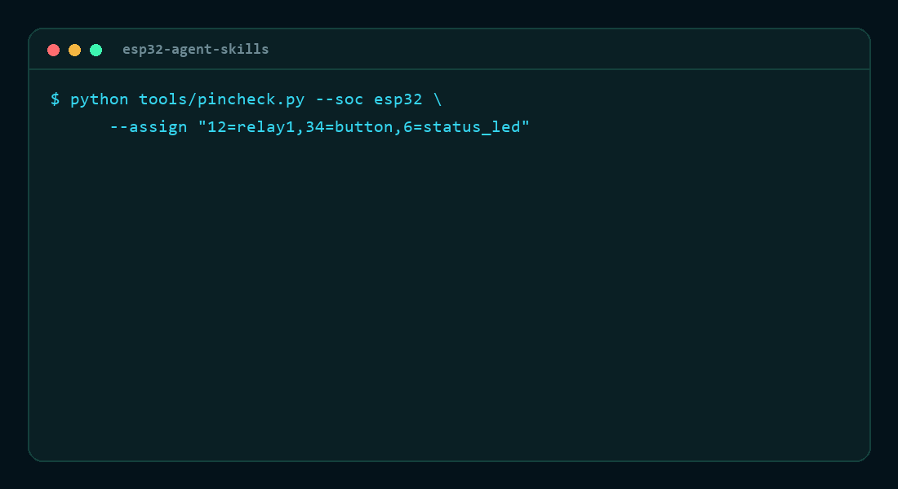

# ESP32 Agent Skills

A practical ESP32 engineering toolkit for AI coding agents: curated skills, hardware-aware guardrails, and command-line validation tools that catch mistakes before a board is flashed.


[](LICENSE)
[](https://www.python.org/)
[](https://github.com/Esmail-sarhadi/esp32-agent-skills/actions/workflows/test.yml)

[Read the project site →](https://esmail-sarhadi.github.io/esp32-agent-skills/)

## Why this exists

AI coding agents can write ESP32 firmware that compiles cleanly and still fails on hardware. The most common failures are not logic bugs; they are hardware constraints hidden in the pin map, boot settings, power budget, and protocol boundaries.

Examples:

- GPIO6 tied to SPI flash
- GPIO34 used as an output when it is input-only
- GPIO12 held high during reset on a 3.3 V flash board
- ADC2 readings failing while Wi‑Fi is active

This repository gives the agent the missing knowledge and gives the workflow a check that runs before flashing.



## What is included

- Skills for ESP32 architecture, GPIO, power, memory, OTA, Wi‑Fi/BLE, Modbus, CAN, sensors, debugging, and industrial interfaces
- Hardware-focused validation tools for common failure modes
- Agent-installation support for multiple harnesses and plugins
- Example boards, test data, and engineering references

## Quick start

Clone and validate a pin map:

```bash
git clone https://github.com/Esmail-sarhadi/esp32-agent-skills.git
cd esp32-agent-skills
python tools/pincheck.py --soc esp32 --assign "12=relay,34=button,25=led"
```

Example output:

```text
ESP32 (classic, WROOM-32 / WROVER) - 3 pin(s) checked

  GPIO6   ERROR  status_led     GPIO6 is connected to the SPI flash, using it bricks the module
  GPIO12  WARN   relay1         GPIO12 is a strapping pin and must be LOW at boot on 3.3 V flash
                                modules, HIGH selects 1.8 V and the board will not boot
  GPIO34  WARN   button         GPIO34 is input-only: it cannot drive an output and has no internal
                                pull-up or pull-down

  1 error(s), 2 warning(s)
```

Check a partition layout:

```bash
python tools/partition_check.py --file examples/partitions-ota-4mb.csv --flash 4MB --ota
```

Check the power budget:

```bash
python tools/power_budget.py --battery 3000 --wakes-per-hour 12 --wake-ms 2000
```

## Install as an agent skill

This repository follows the skill layout used by agent toolchains, with content split between short operational guidance and longer reference material.

### Claude Code plugin

```bash
/plugin marketplace add Esmail-sarhadi/esp32-agent-skills
/plugin install esp32-agent-skills
```

### Local harness install

```bash
./install.sh --harness claude
./install.sh --harness codex
./install.sh --harness opencode
./install.sh --harness all
```

PowerShell variants are also provided:

```powershell
./install.ps1 -Harness codex
./install.ps1 -Harness all -DryRun
```

See [harnesses/README.md](harnesses/README.md) for supported locations and capability boundaries.

## Included tools

| Tool | Purpose |
|---|---|
| `tools/pincheck.py` | Validate GPIO usage against ESP32 SoC constraints |
| `tools/partition_check.py` | Check partition layout and OTA alignment |
| `tools/power_budget.py` | Estimate runtime and dominant current draw |
| `tools/panic_decode.py` | Decode crash dumps and backtraces |
| `tools/airtime.py` | Check LoRa airtime and duty-cycle feasibility |
| `tools/modbus_map_check.py` | Validate Modbus register maps |
| `tools/modbus_frame.py` | Validate RTU framing and timing |
| `tools/mqtt_topic_check.py` | Validate MQTT topic filters and naming |
| `tools/flash_layout.py` | Detect overlapping firmware or flash regions |
| `tools/i2c_address_check.py` | Detect duplicate or reserved I²C addresses |
| `tools/esp32_skills_cli.py` | One entry point for every checker in the repository |
| `tools/render_pin_table.py` | Render `data/esp32-pins.json` into a human-readable reference table |
| `tools/gen_manifest.py` | Generate `agent.yaml` and plugin manifests from the skills directory |
| `tools/gen_readme_catalog.py` | Regenerate the skills catalog in this README from `SKILL.md` frontmatter |
| `tools/validate_skills.py` | Validate every `SKILL.md` against `schemas/skill.schema.json` |

## Skills catalog

The repository now contains **644 skills**. The latest 400-skill expansion is indexed in [docs/advanced-skill-expansion.md](docs/advanced-skill-expansion.md).

<!-- SKILLS CATALOG START -->

Generated by `tools/gen_readme_catalog.py` from each `SKILL.md` frontmatter. Do not edit the table by hand.

| Skill | Covers |
|---|---|
| `adc2-wifi-target-specific-arbitration` | Analog reads fail or return errors when Wi-Fi starts, or ADC2 behavior changes across ESP32 families. Establish target-specific constraints, evidence, failure analysis and measurable verification before release. |
| `ble-scan-window-coexistence-audit` | BLE scanners miss advertisements or behave differently when Wi-Fi is active. Establish target-specific constraints, evidence, failure analysis and measurable verification before release. |
| `brownout-rail-transient-measurement` | The ESP32 reboots when Wi-Fi transmits, a relay or motor switches, or peripherals start. Establish target-specific constraints, evidence, failure analysis and measurable verification before release. |
| `brownout-safe-actuator-reset-state` | Relays, valves or motors momentarily energize or remain latched during reset, brownout or OTA reboot. Establish target-specific constraints, evidence, failure analysis and measurable verification before release. |
| `brownout-vs-watchdog-reset-classification` | Random reset reports are ambiguous or teams apply power fixes to software deadlocks and vice versa. Establish target-specific constraints, evidence, failure analysis and measurable verification before release. |
| `deep-sleep-immediate-wakeup-diagnosis` | ESP32 enters deep sleep but wakes immediately or reports an unexpected wake cause. Establish target-specific constraints, evidence, failure analysis and measurable verification before release. |
| `deep-sleep-timer-wakeup-reliability` | A battery-powered node sometimes fails to wake on its timer after deep sleep. Establish target-specific constraints, evidence, failure analysis and measurable verification before release. |
| `dns-stale-cache-and-failover` | The device has an IP address but cannot resolve hostnames or continues using an obsolete endpoint after network changes. Establish target-specific constraints, evidence, failure analysis and measurable verification before release. |
| `esp32-0-10v-input-protection` | Designing, reviewing, debugging or validating 0 10v input protection for ESP32 firmware; apply target-specific constraints, failure analysis and measurable verification before release. |
| `esp32-4-20ma-loop-compliance` | Designing, reviewing, debugging or validating 4 20ma loop compliance for ESP32 firmware; apply target-specific constraints, failure analysis and measurable verification before release. |
| `esp32-4-20ma-transmitter` | An ESP32 must drive a 4-20 mA current loop - as a transmitter into a PLC, a valve command, or a two-wire loop. Covers XTR116-class parts, loop power, isolation and the live-zero rule. |
| `esp32-actuator-manual-override` | Designing, reviewing, debugging or validating actuator manual override for ESP32 firmware; apply target-specific constraints, failure analysis and measurable verification before release. |
| `esp32-actuator-safe-reset-state` | Designing, reviewing, debugging or validating actuator safe reset state for ESP32 firmware; apply target-specific constraints, failure analysis and measurable verification before release. |
| `esp32-actuators-and-relays` | An ESP32 drives a relay, solenoid, servo or motor - the coil browns out the board, the relay clicks but the contact does nothing, the servo jitters, or the LED glows when it should be off. Covers drive circuits, flyback, inrush and isolation. |
| `esp32-adc-and-sensors` | Reading an analog sensor on an ESP32 - the reading is noisy, saturates, drifts, or returns nonsense once Wi-Fi connects. Covers ADC1 vs ADC2, attenuation, calibration, source impedance and averaging. |
| `esp32-adc-calibration-linearity` | Reviewing or implementing esp32 adc calibration linearity on an ESP32 target. |
| `esp32-adc-oversampling-validity` | Designing, reviewing, debugging or validating adc oversampling validity for ESP32 firmware; apply target-specific constraints, failure analysis and measurable verification before release. |
| `esp32-adc-pin-allocation` | Designing, reviewing, debugging or validating adc pin allocation for ESP32 firmware; apply target-specific constraints, failure analysis and measurable verification before release. |
| `esp32-adc-reference-error-budget` | Designing, reviewing, debugging or validating adc reference error budget for ESP32 firmware; apply target-specific constraints, failure analysis and measurable verification before release. |
| `esp32-adc-source-impedance-review` | Designing, reviewing, debugging or validating adc source impedance review for ESP32 firmware; apply target-specific constraints, failure analysis and measurable verification before release. |
| `esp32-addressable-leds` | Driving WS2812, SK6812 or APA102 strips from an ESP32 - power sizing, the 3.3 V data problem, colour order, refresh budget and why a strip flickers once Wi-Fi is on. |
| `esp32-ads1115-external-adc` | The ESP32's own ADC is not good enough - 12 bits of noise, ADC2 dead under Wi-Fi, or a sensor 5 m away. Covers ADS1115 wiring, PGA, single-ended vs differential and the input range trap. |
| `esp32-ads1256-precision-adc` | A measurement needs more than 16 bits - strain, load cells, precision current shunts or thermocouples - and an ADS1256 is on SPI. Covers the reference, the crystal, the DRDY line and the noise budget. |
| `esp32-aes-gcm-multipart-stream-integrity` | A firmware uses PSA AEAD or mbedTLS GCM multipart updates and chunk boundaries can be non-block-aligned. |
| `esp32-allocation-free-hot-path` | Designing, reviewing, debugging or validating allocation free hot path for ESP32 firmware; apply target-specific constraints, failure analysis and measurable verification before release. |
| `esp32-analog-anti-alias-filter` | Designing, reviewing, debugging or validating analog anti alias filter for ESP32 firmware; apply target-specific constraints, failure analysis and measurable verification before release. |
| `esp32-analog-isolation-boundary` | Designing, reviewing, debugging or validating analog isolation boundary for ESP32 firmware; apply target-specific constraints, failure analysis and measurable verification before release. |
| `esp32-antenna-enclosure-detuning` | Designing, reviewing, debugging or validating antenna enclosure detuning for ESP32 firmware; apply target-specific constraints, failure analysis and measurable verification before release. |
| `esp32-antenna-impedance-review` | Designing, reviewing, debugging or validating antenna impedance review for ESP32 firmware; apply target-specific constraints, failure analysis and measurable verification before release. |
| `esp32-anti-rollback-policy` | Reviewing or implementing esp32 anti rollback policy on an ESP32 target. |
| `esp32-anti-rollback-version-policy` | Designing, reviewing, debugging or validating anti rollback version policy for ESP32 firmware; apply target-specific constraints, failure analysis and measurable verification before release. |
| `esp32-append-only-log-design` | Designing, reviewing, debugging or validating append only log design for ESP32 firmware; apply target-specific constraints, failure analysis and measurable verification before release. |
| `esp32-atomic-operation-review` | Designing, reviewing, debugging or validating atomic operation review for ESP32 firmware; apply target-specific constraints, failure analysis and measurable verification before release. |
| `esp32-audio-buffer-underrun` | Reviewing or implementing esp32 audio buffer underrun on an ESP32 target. |
| `esp32-audio-codec-register-sequence` | Designing, reviewing, debugging or validating audio codec register sequence for ESP32 firmware; apply target-specific constraints, failure analysis and measurable verification before release. |
| `esp32-audio-dma-buffer-sizing` | Designing, reviewing, debugging or validating audio dma buffer sizing for ESP32 firmware; apply target-specific constraints, failure analysis and measurable verification before release. |
| `esp32-audio-i2s` | ESP32 plays or records audio - clicks and pops, wrong pitch, buffer underruns, a microphone that returns silence, or a codec that will not lock. Covers I2S clocking, DMA buffers and master/slave roles. |
| `esp32-audio-latency-budget` | Designing, reviewing, debugging or validating audio latency budget for ESP32 firmware; apply target-specific constraints, failure analysis and measurable verification before release. |
| `esp32-audio-resampling-drift` | Designing, reviewing, debugging or validating audio resampling drift for ESP32 firmware; apply target-specific constraints, failure analysis and measurable verification before release. |
| `esp32-audio-sample-rate-conversion` | Designing, reviewing, debugging or validating audio sample rate conversion for ESP32 firmware; apply target-specific constraints, failure analysis and measurable verification before release. |
| `esp32-audio-underrun-recovery` | Designing, reviewing, debugging or validating audio underrun recovery for ESP32 firmware; apply target-specific constraints, failure analysis and measurable verification before release. |
| `esp32-authorization-role-model` | Designing, reviewing, debugging or validating authorization role model for ESP32 firmware; apply target-specific constraints, failure analysis and measurable verification before release. |
| `esp32-barcode-qr-provisioning-flow` | Designing, reviewing, debugging or validating barcode qr provisioning flow for ESP32 firmware; apply target-specific constraints, failure analysis and measurable verification before release. |
| `esp32-batch-provisioning` | More than a handful of ESP32s need Wi-Fi credentials - each unit is typed in by hand, provisioning fails on Android but works on iOS, the QR payload is rejected, or a batch needs the same settings. Covers SoftAP, BLE and QR provisioning plus batch flashing. |
| `esp32-battery-and-charging` | A battery-powered ESP32 dies early, the fuel gauge lies, the charger never finishes, or the board resets at low battery. Covers chargers, protection, measurement and the load-sharing problem. |
| `esp32-battery-chemistry-selection` | Designing, reviewing, debugging or validating battery chemistry selection for ESP32 firmware; apply target-specific constraints, failure analysis and measurable verification before release. |
| `esp32-battery-fuel-gauge-calibration` | Designing, reviewing, debugging or validating battery fuel gauge calibration for ESP32 firmware; apply target-specific constraints, failure analysis and measurable verification before release. |
| `esp32-battery-protection-boundary` | Designing, reviewing, debugging or validating battery protection boundary for ESP32 firmware; apply target-specific constraints, failure analysis and measurable verification before release. |
| `esp32-battery-state-estimation` | Reviewing or implementing esp32 battery state estimation on an ESP32 target., including target-specific constraints and repeatable validation steps. |
| `esp32-binary-artifact-retention` | Designing, reviewing, debugging or validating binary artifact retention for ESP32 firmware; apply target-specific constraints, failure analysis and measurable verification before release. |
| `esp32-binary-size-regression` | Designing, reviewing, debugging or validating binary size regression for ESP32 firmware; apply target-specific constraints, failure analysis and measurable verification before release. |
| `esp32-ble-bond-lifecycle` | Designing, reviewing, debugging or validating ble bond lifecycle for ESP32 firmware; apply target-specific constraints, failure analysis and measurable verification before release. |
| `esp32-ble-connection-interval-budget` | Designing, reviewing, debugging or validating ble connection interval budget for ESP32 firmware; apply target-specific constraints, failure analysis and measurable verification before release. |
| `esp32-ble-connection-telemetry` | Designing, reviewing, debugging or validating ble connection telemetry for ESP32 firmware; apply target-specific constraints, failure analysis and measurable verification before release. |
| `esp32-ble-factory-reset-identity` | Designing, reviewing, debugging or validating ble factory reset identity for ESP32 firmware; apply target-specific constraints, failure analysis and measurable verification before release. |
| `esp32-ble-firmware-update-transport` | Designing, reviewing, debugging or validating ble firmware update transport for ESP32 firmware; apply target-specific constraints, failure analysis and measurable verification before release. |
| `esp32-ble-gatt` | Building or debugging a BLE peripheral on ESP32 - the phone cannot see the device, notifications stop after a reconnect, throughput is a tenth of what was expected, or pairing works once and never again. Covers GATT design, MTU, connection parameters and bonding. |
| `esp32-ble-gatt-cache-invalidation` | Designing, reviewing, debugging or validating ble gatt cache invalidation for ESP32 firmware; apply target-specific constraints, failure analysis and measurable verification before release. |
| `esp32-ble-gatt-contract-review` | Reviewing or implementing esp32 ble gatt contract review on an ESP32 target., including target-specific constraints and repeatable validation steps. |
| `esp32-ble-gatt-regression` | Reviewing or implementing esp32 ble gatt regression on an ESP32 target. |
| `esp32-ble-indication-confirmation` | Designing, reviewing, debugging or validating ble indication confirmation for ESP32 firmware; apply target-specific constraints, failure analysis and measurable verification before release. |
| `esp32-ble-long-write-validation` | Designing, reviewing, debugging or validating ble long write validation for ESP32 firmware; apply target-specific constraints, failure analysis and measurable verification before release. |
| `esp32-ble-malformed-packet-hardening` | Designing, reviewing, debugging or validating ble malformed packet hardening for ESP32 firmware; apply target-specific constraints, failure analysis and measurable verification before release. |
| `esp32-ble-mobile-interoperability` | Designing, reviewing, debugging or validating ble mobile interoperability for ESP32 firmware; apply target-specific constraints, failure analysis and measurable verification before release. |
| `esp32-ble-mtu-throughput-budget` | Designing, reviewing, debugging or validating ble mtu throughput budget for ESP32 firmware; apply target-specific constraints, failure analysis and measurable verification before release. |
| `esp32-ble-multiple-central-policy` | Designing, reviewing, debugging or validating ble multiple central policy for ESP32 firmware; apply target-specific constraints, failure analysis and measurable verification before release. |
| `esp32-ble-notification-backpressure` | Designing, reviewing, debugging or validating ble notification backpressure for ESP32 firmware; apply target-specific constraints, failure analysis and measurable verification before release. |
| `esp32-ble-pairing-mode-selection` | Designing, reviewing, debugging or validating ble pairing mode selection for ESP32 firmware; apply target-specific constraints, failure analysis and measurable verification before release. |
| `esp32-ble-pairing-security` | Reviewing or implementing esp32 ble pairing security on an ESP32 target., including target-specific constraints and repeatable validation steps. |
| `esp32-ble-privacy-address-policy` | Designing, reviewing, debugging or validating ble privacy address policy for ESP32 firmware; apply target-specific constraints, failure analysis and measurable verification before release. |
| `esp32-ble-provisioning-state-machine` | Designing, reviewing, debugging or validating ble provisioning state machine for ESP32 firmware; apply target-specific constraints, failure analysis and measurable verification before release. |
| `esp32-ble-qr-secret-design` | Designing, reviewing, debugging or validating ble qr secret design for ESP32 firmware; apply target-specific constraints, failure analysis and measurable verification before release. |
| `esp32-ble-service-versioning` | Designing, reviewing, debugging or validating ble service versioning for ESP32 firmware; apply target-specific constraints, failure analysis and measurable verification before release. |
| `esp32-ble-throughput-latency` | Reviewing or implementing esp32 ble throughput latency on an ESP32 target., including target-specific constraints and repeatable validation steps. |
| `esp32-bluetooth-wifi-coexistence` | Designing, reviewing, debugging or validating bluetooth wifi coexistence for ESP32 firmware; apply target-specific constraints, failure analysis and measurable verification before release. |
| `esp32-board-capability-matrix` | Reviewing or implementing esp32 board capability matrix on an ESP32 target., including target-specific constraints and repeatable validation steps. |
| `esp32-board-power-sequencing-audit` | Peripheral back-powering, USB connector interactions or different startup orders cause intermittent boot failures. Establish target-specific constraints, evidence, failure analysis and measurable verification before release. |
| `esp32-board-revision-migration` | Designing, reviewing, debugging or validating board revision migration for ESP32 firmware; apply target-specific constraints, failure analysis and measurable verification before release. |
| `esp32-board-schematic-intake` | Designing, reviewing, debugging or validating board schematic intake for ESP32 firmware; apply target-specific constraints, failure analysis and measurable verification before release. |
| `esp32-boot-mode-qualification` | Designing, reviewing, debugging or validating boot mode qualification for ESP32 firmware; apply target-specific constraints, failure analysis and measurable verification before release. |
| `esp32-boundary-value-test-design` | Designing, reviewing, debugging or validating boundary value test design for ESP32 firmware; apply target-specific constraints, failure analysis and measurable verification before release. |
| `esp32-braking-energy-path` | Designing, reviewing, debugging or validating braking energy path for ESP32 firmware; apply target-specific constraints, failure analysis and measurable verification before release. |
| `esp32-bridge-excitation-stability` | Designing, reviewing, debugging or validating bridge excitation stability for ESP32 firmware; apply target-specific constraints, failure analysis and measurable verification before release. |
| `esp32-brownout-log-correlation` | Designing, reviewing, debugging or validating brownout log correlation for ESP32 firmware; apply target-specific constraints, failure analysis and measurable verification before release. |
| `esp32-brownout-root-cause` | Reviewing or implementing esp32 brownout root cause on an ESP32 target., including target-specific constraints and repeatable validation steps. |
| `esp32-brownout-threshold-validation` | Designing, reviewing, debugging or validating brownout threshold validation for ESP32 firmware; apply target-specific constraints, failure analysis and measurable verification before release. |
| `esp32-build-and-sdkconfig` | The build itself is the problem - settings do not take effect, PlatformIO and IDF disagree, a flag is silently overridden, the binary is too big, or the same source builds differently on two machines. Covers sdkconfig, build flags and partition choice. |
| `esp32-build-flag-precedence-audit` | Designing, reviewing, debugging or validating build flag precedence audit for ESP32 firmware; apply target-specific constraints, failure analysis and measurable verification before release. |
| `esp32-build-provenance-attestation` | Designing, reviewing, debugging or validating build provenance attestation for ESP32 firmware; apply target-specific constraints, failure analysis and measurable verification before release. |
| `esp32-c5-psram-crypto-alignment-qualification` | Qualifying AES or SHA hardware operations when input or output buffers may reside in PSRAM on affected ESP32-C5 and ESP-IDF combinations. |
| `esp32-c5-reset-psram-ota-rollback-interaction` | Reviewing reset hangs and unexpected OTA rollback on ESP32-C5 with PSRAM and affected ESP-IDF versions. |
| `esp32-c6-wifi-ble-802154-coexistence` | ESP32-C6 products use Wi-Fi, BLE and IEEE 802.15.4 concurrently and see packet starvation or long-run stalls. Establish target-specific constraints, evidence, failure analysis and measurable verification before release. |
| `esp32-cache-coherency-boundary` | Designing, reviewing, debugging or validating cache coherency boundary for ESP32 firmware; apply target-specific constraints, failure analysis and measurable verification before release. |
| `esp32-calibration-coefficient-traceability` | Designing, reviewing, debugging or validating calibration coefficient traceability for ESP32 firmware; apply target-specific constraints, failure analysis and measurable verification before release. |
| `esp32-calibration-temperature-compensation` | Designing, reviewing, debugging or validating calibration temperature compensation for ESP32 firmware; apply target-specific constraints, failure analysis and measurable verification before release. |
| `esp32-camera-frame-ownership` | Designing, reviewing, debugging or validating camera frame ownership for ESP32 firmware; apply target-specific constraints, failure analysis and measurable verification before release. |
| `esp32-camera-framebuffer-budget` | Reviewing or implementing esp32 camera framebuffer budget on an ESP32 target. |
| `esp32-camera-low-light-exposure-control` | Designing, reviewing, debugging or validating camera low light exposure control for ESP32 firmware; apply target-specific constraints, failure analysis and measurable verification before release. |
| `esp32-camera-pipeline` | An ESP32 camera does not initialise, reboots when the flash fires, produces green or torn frames, or streams too slowly. Covers OV2640 limits, PSRAM framebuffers and the power budget that the camera hides. |
| `esp32-camera-power-sequencing` | Designing, reviewing, debugging or validating camera power sequencing for ESP32 firmware; apply target-specific constraints, failure analysis and measurable verification before release. |
| `esp32-camera-psram-bandwidth-budget` | Designing, reviewing, debugging or validating camera psram bandwidth budget for ESP32 firmware; apply target-specific constraints, failure analysis and measurable verification before release. |
| `esp32-camera-xclk-timing-validation` | Designing, reviewing, debugging or validating camera xclk timing validation for ESP32 firmware; apply target-specific constraints, failure analysis and measurable verification before release. |
| `esp32-can-bit-timing-calculation` | Designing, reviewing, debugging or validating can bit timing calculation for ESP32 firmware; apply target-specific constraints, failure analysis and measurable verification before release. |
| `esp32-can-bus-load-budget` | Designing, reviewing, debugging or validating can bus load budget for ESP32 firmware; apply target-specific constraints, failure analysis and measurable verification before release. |
| `esp32-can-bus-off-recovery-policy` | Designing, reviewing, debugging or validating can bus off recovery policy for ESP32 firmware; apply target-specific constraints, failure analysis and measurable verification before release. |
| `esp32-can-fd-gateway` | Building CAN or CAN-FD gateways with ESP32, including TWAI, external CAN-FD controllers, bus-off recovery and industrial isolation. |
| `esp32-can-twai` | An ESP32 joins a CAN bus - no frames arrive, the bus goes off after a while, the bitrate will not match, or the transceiver is missing. Covers TWAI setup, termination, bitrate and bus-off recovery. |
| `esp32-can-twai-bus-off-recovery` | Reviewing or implementing esp32 can twai bus off recovery on an ESP32 target. |
| `esp32-canopen-basics` | An ESP32 joins a CANopen network - drives, IO modules or sensors - and the node stays in pre-operational, PDOs never arrive, or SDO reads time out. Covers NMT, node IDs, COB-IDs and heartbeat. |
| `esp32-canopen-heartbeat-consumer` | Designing, reviewing, debugging or validating canopen heartbeat consumer for ESP32 firmware; apply target-specific constraints, failure analysis and measurable verification before release. |
| `esp32-canopen-node-commissioning` | Reviewing or implementing esp32 canopen node commissioning on an ESP32 target. |
| `esp32-canopen-pdo-mapping-review` | Designing, reviewing, debugging or validating canopen pdo mapping review for ESP32 firmware; apply target-specific constraints, failure analysis and measurable verification before release. |
| `esp32-canopen-safety-boundary` | Reviewing or implementing esp32 canopen safety boundary on an ESP32 target. |
| `esp32-captive-portal-detection` | Designing, reviewing, debugging or validating captive portal detection for ESP32 firmware; apply target-specific constraints, failure analysis and measurable verification before release. |
| `esp32-cc1101-subghz` | Integrating CC1101 sub-GHz radios, diagnosing packet loss, selecting RF settings or building a low-power point-to-point link. |
| `esp32-charger-powerpath-review` | Reviewing or implementing esp32 charger powerpath review on an ESP32 target., including target-specific constraints and repeatable validation steps. |
| `esp32-charger-termination-review` | Designing, reviewing, debugging or validating charger termination review for ESP32 firmware; apply target-specific constraints, failure analysis and measurable verification before release. |
| `esp32-chip-revision-audit` | Designing, reviewing, debugging or validating chip revision audit for ESP32 firmware; apply target-specific constraints, failure analysis and measurable verification before release. |
| `esp32-ci-target-matrix-design` | Designing, reviewing, debugging or validating ci target matrix design for ESP32 firmware; apply target-specific constraints, failure analysis and measurable verification before release. |
| `esp32-circular-log-retention` | Designing, reviewing, debugging or validating circular log retention for ESP32 firmware; apply target-specific constraints, failure analysis and measurable verification before release. |
| `esp32-clock-source-selection` | Designing, reviewing, debugging or validating clock source selection for ESP32 firmware; apply target-specific constraints, failure analysis and measurable verification before release. |
| `esp32-closed-loop-control-saturation` | Designing, reviewing, debugging or validating closed loop control saturation for ESP32 firmware; apply target-specific constraints, failure analysis and measurable verification before release. |
| `esp32-compiler-warning-policy` | Designing, reviewing, debugging or validating compiler warning policy for ESP32 firmware; apply target-specific constraints, failure analysis and measurable verification before release. |
| `esp32-complementary-pwm-safety` | Designing, reviewing, debugging or validating complementary pwm safety for ESP32 firmware; apply target-specific constraints, failure analysis and measurable verification before release. |
| `esp32-component-license-compliance` | Designing, reviewing, debugging or validating component license compliance for ESP32 firmware; apply target-specific constraints, failure analysis and measurable verification before release. |
| `esp32-concurrency-stress-testing` | Designing, reviewing, debugging or validating concurrency stress testing for ESP32 firmware; apply target-specific constraints, failure analysis and measurable verification before release. |
| `esp32-configuration-schema-migration` | Designing, reviewing, debugging or validating configuration schema migration for ESP32 firmware; apply target-specific constraints, failure analysis and measurable verification before release. |
| `esp32-configuration-transactionality` | Reviewing or implementing esp32 configuration transactionality on an ESP32 target. |
| `esp32-contactor-feedback-monitor` | Designing, reviewing, debugging or validating contactor feedback monitor for ESP32 firmware; apply target-specific constraints, failure analysis and measurable verification before release. |
| `esp32-core-dump-retention-policy` | Designing, reviewing, debugging or validating core dump retention policy for ESP32 firmware; apply target-specific constraints, failure analysis and measurable verification before release. |
| `esp32-corrective-action-regression` | Designing, reviewing, debugging or validating corrective action regression for ESP32 firmware; apply target-specific constraints, failure analysis and measurable verification before release. |
| `esp32-cpu-frequency-policy` | Designing, reviewing, debugging or validating cpu frequency policy for ESP32 firmware; apply target-specific constraints, failure analysis and measurable verification before release. |
| `esp32-crash-consistent-file-update` | Designing, reviewing, debugging or validating crash consistent file update for ESP32 firmware; apply target-specific constraints, failure analysis and measurable verification before release. |
| `esp32-crash-loop-containment` | Designing, reviewing, debugging or validating crash loop containment for ESP32 firmware; apply target-specific constraints, failure analysis and measurable verification before release. |
| `esp32-credential-revocation-flow` | Designing, reviewing, debugging or validating credential revocation flow for ESP32 firmware; apply target-specific constraints, failure analysis and measurable verification before release. |
| `esp32-credential-storage-policy` | Designing, reviewing, debugging or validating credential storage policy for ESP32 firmware; apply target-specific constraints, failure analysis and measurable verification before release. |
| `esp32-critical-section-audit` | Designing, reviewing, debugging or validating critical section audit for ESP32 firmware; apply target-specific constraints, failure analysis and measurable verification before release. |
| `esp32-cross-core-data-ownership` | Designing, reviewing, debugging or validating cross core data ownership for ESP32 firmware; apply target-specific constraints, failure analysis and measurable verification before release. |
| `esp32-crystal-layout-review` | Designing, reviewing, debugging or validating crystal layout review for ESP32 firmware; apply target-specific constraints, failure analysis and measurable verification before release. |
| `esp32-dac-output-accuracy` | Reviewing or implementing esp32 dac output accuracy on an ESP32 target. |
| `esp32-data-retention-policy` | Designing, reviewing, debugging or validating data retention policy for ESP32 firmware; apply target-specific constraints, failure analysis and measurable verification before release. |
| `esp32-debug-header-contract` | Designing, reviewing, debugging or validating debug header contract for ESP32 firmware; apply target-specific constraints, failure analysis and measurable verification before release. |
| `esp32-debug-port-production-lock` | Designing, reviewing, debugging or validating debug port production lock for ESP32 firmware; apply target-specific constraints, failure analysis and measurable verification before release. |
| `esp32-debugging` | An ESP32 crashes, reboots, or prints a Guru Meditation dump - decoding the backtrace, enabling the exception decoder, reading a core dump, and telling a panic from a watchdog from a brownout. |
| `esp32-deep-sleep-current-audit` | Reviewing or implementing esp32 deep sleep current audit on an ESP32 target., including target-specific constraints and repeatable validation steps. |
| `esp32-deferred-interrupt-work` | Designing, reviewing, debugging or validating deferred interrupt work for ESP32 firmware; apply target-specific constraints, failure analysis and measurable verification before release. |
| `esp32-degraded-mode-operation` | Designing, reviewing, debugging or validating degraded mode operation for ESP32 firmware; apply target-specific constraints, failure analysis and measurable verification before release. |
| `esp32-dependency-lockfile-integrity` | Designing, reviewing, debugging or validating dependency lockfile integrity for ESP32 firmware; apply target-specific constraints, failure analysis and measurable verification before release. |
| `esp32-dependency-vulnerability-triage` | Reviewing or implementing esp32 dependency vulnerability triage on an ESP32 target. |
| `esp32-deterministic-test-fixtures` | Designing, reviewing, debugging or validating deterministic test fixtures for ESP32 firmware; apply target-specific constraints, failure analysis and measurable verification before release. |
| `esp32-device-certificate-enrollment` | Designing, reviewing, debugging or validating device certificate enrollment for ESP32 firmware; apply target-specific constraints, failure analysis and measurable verification before release. |
| `esp32-device-identity-duplicate-detection` | Designing, reviewing, debugging or validating device identity duplicate detection for ESP32 firmware; apply target-specific constraints, failure analysis and measurable verification before release. |
| `esp32-device-identity-provisioning` | Reviewing or implementing esp32 device identity provisioning on an ESP32 target. |
| `esp32-device-identity-rotation` | Designing, reviewing, debugging or validating device identity rotation for ESP32 firmware; apply target-specific constraints, failure analysis and measurable verification before release. |
| `esp32-diagnostic-log-rate-limit` | Designing, reviewing, debugging or validating diagnostic log rate limit for ESP32 firmware; apply target-specific constraints, failure analysis and measurable verification before release. |
| `esp32-din-rail-power` | An ESP32 board lives in a control cabinet - 24 V DC rail, wide input, isolated output, hold-up through a contactor drop. Covers buck selection, inrush, reverse protection and the 24 V to 3.3 V budget. |
| `esp32-display-brightness-power-budget` | Designing, reviewing, debugging or validating display brightness power budget for ESP32 firmware; apply target-specific constraints, failure analysis and measurable verification before release. |
| `esp32-display-bus-bandwidth-budget` | Designing, reviewing, debugging or validating display bus bandwidth budget for ESP32 firmware; apply target-specific constraints, failure analysis and measurable verification before release. |
| `esp32-display-framebuffer-placement` | Designing, reviewing, debugging or validating display framebuffer placement for ESP32 firmware; apply target-specific constraints, failure analysis and measurable verification before release. |
| `esp32-display-tearing-prevention` | Designing, reviewing, debugging or validating display tearing prevention for ESP32 firmware; apply target-specific constraints, failure analysis and measurable verification before release. |
| `esp32-display-tearing-sync` | Reviewing or implementing esp32 display tearing sync on an ESP32 target. |
| `esp32-dma-alignment-qualification` | Designing, reviewing, debugging or validating dma alignment qualification for ESP32 firmware; apply target-specific constraints, failure analysis and measurable verification before release. |
| `esp32-dma-buffer-placement` | Reviewing or implementing esp32 dma buffer placement on an ESP32 target., including target-specific constraints and repeatable validation steps. |
| `esp32-dma-cache-psram` | Debugging DMA failures, PSRAM buffers, cache coherency, alignment, camera, SPI, I2S or peripheral transfer corruption. |
| `esp32-dns-failure-diagnostics` | Reviewing or implementing esp32 dns failure diagnostics on an ESP32 target., including target-specific constraints and repeatable validation steps. |
| `esp32-dns-timeout-policy` | Designing, reviewing, debugging or validating dns timeout policy for ESP32 firmware; apply target-specific constraints, failure analysis and measurable verification before release. |
| `esp32-dram-static-budget` | Designing, reviewing, debugging or validating dram static budget for ESP32 firmware; apply target-specific constraints, failure analysis and measurable verification before release. |
| `esp32-dual-copy-config-commit` | Designing, reviewing, debugging or validating dual copy config commit for ESP32 firmware; apply target-specific constraints, failure analysis and measurable verification before release. |
| `esp32-emc-and-enclosure` | A working board fails once it is in its box - range collapses, the sensor drifts, the device resets when a motor runs nearby, or it dies of heat. Covers antenna keepout, grounding, cable routing and thermal limits. |
| `esp32-emergency-stop-interface-boundary` | Designing, reviewing, debugging or validating emergency stop interface boundary for ESP32 firmware; apply target-specific constraints, failure analysis and measurable verification before release. |
| `esp32-enc28j60-ethernet` | An ESP32 uses an ENC28J60 for wired Ethernet - no link, DHCP that never completes, a connection that dies under load, or 2 Mbit/s where 100 was expected. Covers its 8 KB buffer, missing auto-negotiation and SPI limits. |
| `esp32-enclosure-thermal-model` | Designing, reviewing, debugging or validating enclosure thermal model for ESP32 firmware; apply target-specific constraints, failure analysis and measurable verification before release. |
| `esp32-encoder-index-homing` | Designing, reviewing, debugging or validating encoder index homing for ESP32 firmware; apply target-specific constraints, failure analysis and measurable verification before release. |
| `esp32-encoder-pcnt-validation` | Reviewing or implementing esp32 encoder pcnt validation on an ESP32 target. |
| `esp32-encoder-quadrature-integrity` | Designing, reviewing, debugging or validating encoder quadrature integrity for ESP32 firmware; apply target-specific constraints, failure analysis and measurable verification before release. |
| `esp32-encrypted-persistent-records` | Designing, reviewing, debugging or validating encrypted persistent records for ESP32 firmware; apply target-specific constraints, failure analysis and measurable verification before release. |
| `esp32-end-of-line-test-coverage` | Designing, reviewing, debugging or validating end of line test coverage for ESP32 firmware; apply target-specific constraints, failure analysis and measurable verification before release. |
| `esp32-energy-meter-modbus` | An ESP32 reads a Modbus energy meter - SDM120, SDM630, Eastron or similar - and the values are nonsense, swapped, or scaled by 1000. Covers float word order, register tables and polling rates. |
| `esp32-energy-per-operation-budget` | Designing, reviewing, debugging or validating energy per operation budget for ESP32 firmware; apply target-specific constraints, failure analysis and measurable verification before release. |
| `esp32-engineering-change-impact-analysis` | Designing, reviewing, debugging or validating engineering change impact analysis for ESP32 firmware; apply target-specific constraints, failure analysis and measurable verification before release. |
| `esp32-error-code-actionable-triage` | ESP-IDF returns ESP_ERR_* values and the application logs generic failure without recovery context. Establish target-specific constraints, evidence, failure analysis and measurable verification before release. |
| `esp32-esp-idf-version-pinning` | Designing, reviewing, debugging or validating esp idf version pinning for ESP32 firmware; apply target-specific constraints, failure analysis and measurable verification before release. |
| `esp32-esp-now` | ESP32s talk to each other without a router - peers never receive, messages stop after a channel change, the payload is truncated, or the range is far shorter than the datasheet. Covers pairing, channels, encryption and long range mode. |
| `esp32-esp-now-reliability` | Reviewing or implementing esp32 esp now reliability on an ESP32 target., including target-specific constraints and repeatable validation steps. |
| `esp32-esp-timer-isr-task-race-audit` | Diagnosing lost, duplicated or permanently stalled esp_timer callbacks when ISR-dispatched and task-dispatched timers interact. |
| `esp32-espnow-tx-queue-ownership` | Diagnosing ESP-NOW transmit queues that stop progressing, leak buffers or return no-memory errors after bursts. |
| `esp32-ethercat-gateway-boundary` | Evaluating EtherCAT integration, an ESP32 gateway boundary or translating industrial real-time fieldbus data. |
| `esp32-ethernet` | An ESP32 gets a wired connection - the link never comes up, RMII pins conflict with the boot strap, the PHY address is wrong, or the cable works on a laptop and not on the board. Covers LAN8720, W5500 and the clock. |
| `esp32-ethernet-link-recovery` | Reviewing or implementing esp32 ethernet link recovery on an ESP32 target., including target-specific constraints and repeatable validation steps. |
| `esp32-ethernet-rmii-clock-review` | Reviewing or implementing esp32 ethernet rmii clock review on an ESP32 target. |
| `esp32-ethernet-rmii-phy` | Connecting an ESP32 Ethernet MAC to an external RMII PHY such as LAN8720 or IP101 and debugging clock, straps or link negotiation. |
| `esp32-event-group-state-model` | Designing, reviewing, debugging or validating event group state model for ESP32 firmware; apply target-specific constraints, failure analysis and measurable verification before release. |
| `esp32-factory-fixture-interface-contract` | Designing, reviewing, debugging or validating factory fixture interface contract for ESP32 firmware; apply target-specific constraints, failure analysis and measurable verification before release. |
| `esp32-factory-reset-acceptance-test` | Designing, reviewing, debugging or validating factory reset acceptance test for ESP32 firmware; apply target-specific constraints, failure analysis and measurable verification before release. |
| `esp32-factory-reset-data-erasure` | Designing, reviewing, debugging or validating factory reset data erasure for ESP32 firmware; apply target-specific constraints, failure analysis and measurable verification before release. |
| `esp32-factory-test-and-calibration` | Units are built in more than one - the test rig has to pass or fail a board in seconds, calibration values must survive flashing, or a returned unit cannot be identified. Covers the test firmware, the jig and per-unit data. |
| `esp32-fail-safe-output-state` | Reviewing or implementing esp32 fail safe output state on an ESP32 target. |
| `esp32-failure-signature-clustering` | Designing, reviewing, debugging or validating failure signature clustering for ESP32 firmware; apply target-specific constraints, failure analysis and measurable verification before release. |
| `esp32-fat-filesystem-integrity` | Designing, reviewing, debugging or validating fat filesystem integrity for ESP32 firmware; apply target-specific constraints, failure analysis and measurable verification before release. |
| `esp32-fault-counter-persistence` | Designing, reviewing, debugging or validating fault counter persistence for ESP32 firmware; apply target-specific constraints, failure analysis and measurable verification before release. |
| `esp32-fault-injection-hil` | Creating hardware-in-the-loop tests, fault injection, soak tests or regression rigs for ESP32 industrial devices. |
| `esp32-fault-injection-matrix` | Designing, reviewing, debugging or validating fault injection matrix for ESP32 firmware; apply target-specific constraints, failure analysis and measurable verification before release. |
| `esp32-fault-injection-network` | Reviewing or implementing esp32 fault injection network on an ESP32 target. |
| `esp32-fault-injection-power` | Designing controlled power-interruption validation and recovery tests for ESP32 firmware and hardware. |
| `esp32-field-gotchas` | An ESP32 misbehaves in a way the code does not explain - reboots, brownouts, dead I2C, garbled UART, a sketch that will not flash, a crash with no line number. One hundred and sixty failures collected from Stack Overflow, each with the cause and the fix. |
| `esp32-field-recall-evidence-package` | Designing, reviewing, debugging or validating field recall evidence package for ESP32 firmware; apply target-specific constraints, failure analysis and measurable verification before release. |
| `esp32-field-return-to-factory-triage` | Designing, reviewing, debugging or validating field return to factory triage for ESP32 firmware; apply target-specific constraints, failure analysis and measurable verification before release. |
| `esp32-field-telemetry-schema` | Designing, reviewing, debugging or validating field telemetry schema for ESP32 firmware; apply target-specific constraints, failure analysis and measurable verification before release. |
| `esp32-fieldbus-fault-containment` | Designing, reviewing, debugging or validating fieldbus fault containment for ESP32 firmware; apply target-specific constraints, failure analysis and measurable verification before release. |
| `esp32-fieldbus-gateway-buffering` | Designing, reviewing, debugging or validating fieldbus gateway buffering for ESP32 firmware; apply target-specific constraints, failure analysis and measurable verification before release. |
| `esp32-filesystem-full-recovery` | Designing, reviewing, debugging or validating filesystem full recovery for ESP32 firmware; apply target-specific constraints, failure analysis and measurable verification before release. |
| `esp32-firmware-integrity-measurement` | Designing, reviewing, debugging or validating firmware integrity measurement for ESP32 firmware; apply target-specific constraints, failure analysis and measurable verification before release. |
| `esp32-firmware-provenance-attestation` | Reviewing or implementing esp32 firmware provenance attestation on an ESP32 target. |
| `esp32-firmware-sbom-component-inventory` | Designing, reviewing, debugging or validating firmware sbom component inventory for ESP32 firmware; apply target-specific constraints, failure analysis and measurable verification before release. |
| `esp32-firmware-sbom-generation` | Reviewing or implementing esp32 firmware sbom generation on an ESP32 target. |
| `esp32-firmware-size-budget-gate` | Designing, reviewing, debugging or validating firmware size budget gate for ESP32 firmware; apply target-specific constraints, failure analysis and measurable verification before release. |
| `esp32-firmware-version-lockdown` | Designing, reviewing, debugging or validating firmware version lockdown for ESP32 firmware; apply target-specific constraints, failure analysis and measurable verification before release. |
| `esp32-fixture-contact-resistance-check` | Designing, reviewing, debugging or validating fixture contact resistance check for ESP32 firmware; apply target-specific constraints, failure analysis and measurable verification before release. |
| `esp32-fixture-golden-unit-validation` | Designing, reviewing, debugging or validating fixture golden unit validation for ESP32 firmware; apply target-specific constraints, failure analysis and measurable verification before release. |
| `esp32-flash-cache-disabled-isr-audit` | Auditing interrupt handlers and callbacks that can execute while SPI flash cache is disabled or external RAM is inaccessible. |
| `esp32-flash-cache-disabled-path` | Designing, reviewing, debugging or validating flash cache disabled path for ESP32 firmware; apply target-specific constraints, failure analysis and measurable verification before release. |
| `esp32-flash-encryption-key-custody` | Designing, reviewing, debugging or validating flash encryption key custody for ESP32 firmware; apply target-specific constraints, failure analysis and measurable verification before release. |
| `esp32-flash-encryption-production` | Reviewing or implementing esp32 flash encryption production on an ESP32 target. |
| `esp32-flash-psram-capacity` | Reviewing or implementing esp32 flash psram capacity on an ESP32 target., including target-specific constraints and repeatable validation steps. |
| `esp32-flash-vendor-compatibility` | Designing, reviewing, debugging or validating flash vendor compatibility for ESP32 firmware; apply target-specific constraints, failure analysis and measurable verification before release. |
| `esp32-flash-wear-leveling-review` | Designing, reviewing, debugging or validating flash wear leveling review for ESP32 firmware; apply target-specific constraints, failure analysis and measurable verification before release. |
| `esp32-font-asset-memory-budget` | Designing, reviewing, debugging or validating font asset memory budget for ESP32 firmware; apply target-specific constraints, failure analysis and measurable verification before release. |
| `esp32-frame-pool-exhaustion-recovery` | Designing, reviewing, debugging or validating frame pool exhaustion recovery for ESP32 firmware; apply target-specific constraints, failure analysis and measurable verification before release. |
| `esp32-freertos` | Adding tasks, timers or interrupts to an ESP32 sketch, when the device resets with a watchdog or stack overflow, or when two tasks fight over a shared variable. |
| `esp32-gaming-rgb` | Making an ESP32 LED strip appear inside a gaming lighting app such as OpenRGB or SignalRGB, or when the lighting lags behind the screen or the music. |
| `esp32-gatt-characteristic-permissions` | Designing, reviewing, debugging or validating gatt characteristic permissions for ESP32 firmware; apply target-specific constraints, failure analysis and measurable verification before release. |
| `esp32-generated-code-review` | Designing, reviewing, debugging or validating generated code review for ESP32 firmware; apply target-specific constraints, failure analysis and measurable verification before release. |
| `esp32-golden-vector-management` | Designing, reviewing, debugging or validating golden vector management for ESP32 firmware; apply target-specific constraints, failure analysis and measurable verification before release. |
| `esp32-gpio-drive-strength-review` | Designing, reviewing, debugging or validating gpio drive strength review for ESP32 firmware; apply target-specific constraints, failure analysis and measurable verification before release. |
| `esp32-gpio-expander-boundary` | Designing, reviewing, debugging or validating gpio expander boundary for ESP32 firmware; apply target-specific constraints, failure analysis and measurable verification before release. |
| `esp32-gpio-interrupt-load-budget` | Designing, reviewing, debugging or validating gpio interrupt load budget for ESP32 firmware; apply target-specific constraints, failure analysis and measurable verification before release. |
| `esp32-gpio-matrix-audit` | Reviewing or implementing GPIO matrix pin capability, signal routing, and peripheral conflict analysis on an ESP32 target., including target-specific constraints and repeatable validation steps. |
| `esp32-gpio-matrix-route-review` | Designing, reviewing, debugging or validating gpio matrix route review for ESP32 firmware; apply target-specific constraints, failure analysis and measurable verification before release. |
| `esp32-gpio-reset-state-audit` | Designing, reviewing, debugging or validating gpio reset state audit for ESP32 firmware; apply target-specific constraints, failure analysis and measurable verification before release. |
| `esp32-gps-and-nmea` | An ESP32 reads a GPS module - no sentences arrive, the fix never comes, the time is right but the position is not, or the first fix takes ten minutes. Covers UART settings, NMEA parsing, PPS and cold starts. |
| `esp32-hardware-bom-risk-review` | Designing, reviewing, debugging or validating hardware bom risk review for ESP32 firmware; apply target-specific constraints, failure analysis and measurable verification before release. |
| `esp32-hardware-bringup` | Powering a new ESP32 board for the first time, or when a board that used to work stops booting - before changing any firmware. Covers current draw, rails, strapping levels and the order that separates a hardware fault from a software one. |
| `esp32-hardware-in-loop-fixture-contract` | Designing, reviewing, debugging or validating hardware in loop fixture contract for ESP32 firmware; apply target-specific constraints, failure analysis and measurable verification before release. |
| `esp32-hardware-revision-test-matrix` | Designing, reviewing, debugging or validating hardware revision test matrix for ESP32 firmware; apply target-specific constraints, failure analysis and measurable verification before release. |
| `esp32-health-monitor-state-machine` | Designing, reviewing, debugging or validating health monitor state machine for ESP32 firmware; apply target-specific constraints, failure analysis and measurable verification before release. |
| `esp32-heap-capability-allocation` | Designing, reviewing, debugging or validating heap capability allocation for ESP32 firmware; apply target-specific constraints, failure analysis and measurable verification before release. |
| `esp32-heap-forensics` | Investigating heap leaks, fragmentation, allocation failures, TLS memory spikes, reconnect loops or long-uptime instability. |
| `esp32-heap-fragmentation-budget` | Designing, reviewing, debugging or validating heap fragmentation budget for ESP32 firmware; apply target-specific constraints, failure analysis and measurable verification before release. |
| `esp32-heap-fragmentation-forensics` | Reviewing or implementing esp32 heap fragmentation forensics on an ESP32 target. |
| `esp32-hmi-communication-loss-state` | Designing, reviewing, debugging or validating hmi communication loss state for ESP32 firmware; apply target-specific constraints, failure analysis and measurable verification before release. |
| `esp32-http-client-resilience` | Reviewing or implementing esp32 http client resilience on an ESP32 target., including target-specific constraints and repeatable validation steps. |
| `esp32-http-server` | An ESP32 serves HTTP or WebSocket - a handler never fires, large responses truncate, the server stops answering under load, or an upload kills the connection. Covers esp_http_server configuration and handler design. |
| `esp32-http-timeout-budget` | Designing, reviewing, debugging or validating http timeout budget for ESP32 firmware; apply target-specific constraints, failure analysis and measurable verification before release. |
| `esp32-human-interface-localization` | Designing, reviewing, debugging or validating human interface localization for ESP32 firmware; apply target-specific constraints, failure analysis and measurable verification before release. |
| `esp32-i2c-bus` | Adding I2C devices to an ESP32, when a sensor is not detected, or when the bus works alone and fails with a second device. Covers pull-ups, address conflicts, clock stretching and stuck-bus recovery. |
| `esp32-i2c-controller-allocation` | Designing, reviewing, debugging or validating i2c controller allocation for ESP32 firmware; apply target-specific constraints, failure analysis and measurable verification before release. |
| `esp32-i2c-device-discovery` | Reviewing or implementing esp32 i2c device discovery on an ESP32 target., including target-specific constraints and repeatable validation steps. |
| `esp32-i2c-electrical-budget` | Reviewing or implementing esp32 i2c electrical budget on an ESP32 target., including target-specific constraints and repeatable validation steps. |
| `esp32-i2c-multi-master-review` | Reviewing or implementing esp32 i2c multi master review on an ESP32 target., including target-specific constraints and repeatable validation steps. |
| `esp32-i2c-recovery` | An I2C bus hangs, SDA/SCL is stuck, a peripheral powers off independently, or device initialization must recover safely. |
| `esp32-i2s-audio-clock-budget` | Reviewing or implementing esp32 i2s audio clock budget on an ESP32 target. |
| `esp32-i2s-clock-tree-validation` | Designing, reviewing, debugging or validating i2s clock tree validation for ESP32 firmware; apply target-specific constraints, failure analysis and measurable verification before release. |
| `esp32-i2s-pin-route-planning` | Designing, reviewing, debugging or validating i2s pin route planning for ESP32 firmware; apply target-specific constraints, failure analysis and measurable verification before release. |
| `esp32-iec-60870-5-104` | An ESP32 talks to a SCADA master over IEC 60870-5-104 - the connection starts and drops, general interrogation never finishes, or the master reports sequence errors. Covers APCI framing, k/w windows and ASDU types. |
| `esp32-iec104-asdu-mapping-review` | Designing, reviewing, debugging or validating iec104 asdu mapping review for ESP32 firmware; apply target-specific constraints, failure analysis and measurable verification before release. |
| `esp32-imu-calibration-frame` | Reviewing or implementing esp32 imu calibration frame on an ESP32 target. |
| `esp32-inductive-load-clamp-review` | Designing, reviewing, debugging or validating inductive load clamp review for ESP32 firmware; apply target-specific constraints, failure analysis and measurable verification before release. |
| `esp32-industrial-analog-io` | Connecting 4–20 mA loops, 0–10 V transmitters, industrial analog inputs, analog outputs or protected field wiring to ESP32. |
| `esp32-industrial-gateway-architecture` | Designing an ESP32 industrial gateway between Modbus, CAN, Ethernet, Wi-Fi, LoRa, MQTT or cloud services. |
| `esp32-industrial-safety-interlocks` | ESP32 firmware controls relays, contactors, pumps, heaters, valves or machinery where an unsafe output state could damage equipment or injure people; especially when designing interlocks, E-stop behavior or restart policy. |
| `esp32-industrial-timeout-hierarchy` | Designing, reviewing, debugging or validating industrial timeout hierarchy for ESP32 firmware; apply target-specific constraints, failure analysis and measurable verification before release. |
| `esp32-industrial-watchdog-policy` | Reviewing or implementing esp32 industrial watchdog policy on an ESP32 target. |
| `esp32-input-only-signal-planning` | Designing, reviewing, debugging or validating input only signal planning for ESP32 firmware; apply target-specific constraints, failure analysis and measurable verification before release. |
| `esp32-instrumentation-amplifier-selection` | Designing, reviewing, debugging or validating instrumentation amplifier selection for ESP32 firmware; apply target-specific constraints, failure analysis and measurable verification before release. |
| `esp32-intermittent-fault-reproduction` | Designing, reviewing, debugging or validating intermittent fault reproduction for ESP32 firmware; apply target-specific constraints, failure analysis and measurable verification before release. |
| `esp32-ipv6-readiness-review` | Designing, reviewing, debugging or validating ipv6 readiness review for ESP32 firmware; apply target-specific constraints, failure analysis and measurable verification before release. |
| `esp32-iram-dram-budget` | Reviewing or implementing esp32 iram dram budget on an ESP32 target., including target-specific constraints and repeatable validation steps. |
| `esp32-iram-isr-callgraph-audit` | Designing, reviewing, debugging or validating iram isr callgraph audit for ESP32 firmware; apply target-specific constraints, failure analysis and measurable verification before release. |
| `esp32-isolated-digital-input` | An ESP32 reads 24 V industrial signals - a PLC output, a proximity sensor, a dry contact - and the input must survive reverse polarity and ground differences. Covers opto input design, thresholds and debounce. |
| `esp32-isr-latency-budget` | Designing, reviewing, debugging or validating isr latency budget for ESP32 firmware; apply target-specific constraints, failure analysis and measurable verification before release. |
| `esp32-jpeg-encode-backpressure` | Designing, reviewing, debugging or validating jpeg encode backpressure for ESP32 firmware; apply target-specific constraints, failure analysis and measurable verification before release. |
| `esp32-jpeg-streaming-backpressure` | Reviewing or implementing esp32 jpeg streaming backpressure on an ESP32 target. |
| `esp32-json-and-payloads` | JSON on the ESP32 is truncated, crashes, or leaks - the document is empty, the parse fails on a valid payload, floats lose precision, or the heap shrinks with every request. Covers ArduinoJson capacity, streaming and cJSON ownership. |
| `esp32-jtag-lifecycle-control` | Designing, reviewing, debugging or validating jtag lifecycle control for ESP32 firmware; apply target-specific constraints, failure analysis and measurable verification before release. |
| `esp32-jtag-pin-preservation` | Designing, reviewing, debugging or validating jtag pin preservation for ESP32 firmware; apply target-specific constraints, failure analysis and measurable verification before release. |
| `esp32-latency-tail-analysis` | Designing, reviewing, debugging or validating latency tail analysis for ESP32 firmware; apply target-specific constraints, failure analysis and measurable verification before release. |
| `esp32-ledc-channel-allocation` | Designing, reviewing, debugging or validating ledc channel allocation for ESP32 firmware; apply target-specific constraints, failure analysis and measurable verification before release. |
| `esp32-light-sleep-wakeup-design` | Reviewing or implementing esp32 light sleep wakeup design on an ESP32 target. |
| `esp32-limit-switch-debounce` | Designing, reviewing, debugging or validating limit switch debounce for ESP32 firmware; apply target-specific constraints, failure analysis and measurable verification before release. |
| `esp32-linker-map-review` | Designing, reviewing, debugging or validating linker map review for ESP32 firmware; apply target-specific constraints, failure analysis and measurable verification before release. |
| `esp32-linker-script-change-review` | Designing, reviewing, debugging or validating linker script change review for ESP32 firmware; apply target-specific constraints, failure analysis and measurable verification before release. |
| `esp32-littlefs-power-cut-recovery` | Designing, reviewing, debugging or validating littlefs power cut recovery for ESP32 firmware; apply target-specific constraints, failure analysis and measurable verification before release. |
| `esp32-littlefs-wear-budget` | Reviewing or implementing esp32 littlefs wear budget on an ESP32 target. |
| `esp32-littlefs-wear-estimation` | Designing, reviewing, debugging or validating littlefs wear estimation for ESP32 firmware; apply target-specific constraints, failure analysis and measurable verification before release. |
| `esp32-load-cell-creep-compensation` | Designing, reviewing, debugging or validating load cell creep compensation for ESP32 firmware; apply target-specific constraints, failure analysis and measurable verification before release. |
| `esp32-load-cell-noise-budget` | Reviewing or implementing esp32 load cell noise budget on an ESP32 target. |
| `esp32-load-cells-hx711` | Reading load cells with HX711, diagnosing unstable weight, drift, saturation or calibration errors. |
| `esp32-lock-free-ring-buffer-review` | Designing, reviewing, debugging or validating lock free ring buffer review for ESP32 firmware; apply target-specific constraints, failure analysis and measurable verification before release. |
| `esp32-long-duration-soak-test` | Designing, reviewing, debugging or validating long duration soak test for ESP32 firmware; apply target-specific constraints, failure analysis and measurable verification before release. |
| `esp32-lora-and-lorawan` | An ESP32 drives a LoRa radio - the module never answers on SPI, DIO0 never fires, the join request is never accepted, or the gateway hears nothing. Covers SX127x wiring, airtime and duty cycle, and join failures. |
| `esp32-lora-bandwidth-airtime-tradeoff` | Designing, reviewing, debugging or validating lora bandwidth airtime tradeoff for ESP32 firmware; apply target-specific constraints, failure analysis and measurable verification before release. |
| `esp32-lora-coding-rate-selection` | Designing, reviewing, debugging or validating lora coding rate selection for ESP32 firmware; apply target-specific constraints, failure analysis and measurable verification before release. |
| `esp32-lora-frequency-error-budget` | Designing, reviewing, debugging or validating lora frequency error budget for ESP32 firmware; apply target-specific constraints, failure analysis and measurable verification before release. |
| `esp32-lora-link-budget` | Reviewing or implementing esp32 lora link budget on an ESP32 target., including target-specific constraints and repeatable validation steps. |
| `esp32-lora-preamble-detection-budget` | Designing, reviewing, debugging or validating lora preamble detection budget for ESP32 firmware; apply target-specific constraints, failure analysis and measurable verification before release. |
| `esp32-lora-rx-window-scheduling` | Designing, reviewing, debugging or validating lora rx window scheduling for ESP32 firmware; apply target-specific constraints, failure analysis and measurable verification before release. |
| `esp32-lora-spreading-factor-selection` | Designing, reviewing, debugging or validating lora spreading factor selection for ESP32 firmware; apply target-specific constraints, failure analysis and measurable verification before release. |
| `esp32-lorawan-device-lifecycle` | Reviewing or implementing esp32 lorawan device lifecycle on an ESP32 target., including target-specific constraints and repeatable validation steps. |
| `esp32-lorawan-duty-cycle-audit` | Designing, reviewing, debugging or validating lorawan duty cycle audit for ESP32 firmware; apply target-specific constraints, failure analysis and measurable verification before release. |
| `esp32-lorawan-frame-counter-persistence` | Designing, reviewing, debugging or validating lorawan frame counter persistence for ESP32 firmware; apply target-specific constraints, failure analysis and measurable verification before release. |
| `esp32-lorawan-join-lifecycle` | Designing, reviewing, debugging or validating lorawan join lifecycle for ESP32 firmware; apply target-specific constraints, failure analysis and measurable verification before release. |
| `esp32-low-battery-state-machine` | Designing, reviewing, debugging or validating low battery state machine for ESP32 firmware; apply target-specific constraints, failure analysis and measurable verification before release. |
| `esp32-lvgl-and-displays` | An ESP32 drives a display - the panel stays white, the image tears, refresh is too slow, colours are swapped, or LVGL runs out of memory. Covers SPI and RGB panels, DMA buffers, PSRAM and the flush callback. |
| `esp32-lvgl-rendering-budget` | Reviewing or implementing esp32 lvgl rendering budget on an ESP32 target. |
| `esp32-lvgl-task-priority-review` | Designing, reviewing, debugging or validating lvgl task priority review for ESP32 firmware; apply target-specific constraints, failure analysis and measurable verification before release. |
| `esp32-lwip-dns-cache-multi-address-bounds` | Auditing ESP-IDF lwIP DNS cache behavior when CONFIG_LWIP_DNS_MAX_HOST_IP is greater than one or multiple A/AAAA records are returned. |
| `esp32-lwip-network-diagnostics` | An ESP32 connects to Wi-Fi or Ethernet but DNS, DHCP, TCP sockets or long-running network sessions fail; especially when reconnects leak resources or packet loss appears only under load. |
| `esp32-mac-address-allocation-audit` | Designing, reviewing, debugging or validating mac address allocation audit for ESP32 firmware; apply target-specific constraints, failure analysis and measurable verification before release. |
| `esp32-manufacturing-data-retention` | Designing, reviewing, debugging or validating manufacturing data retention for ESP32 firmware; apply target-specific constraints, failure analysis and measurable verification before release. |
| `esp32-manufacturing-variant-matrix` | Designing, reviewing, debugging or validating manufacturing variant matrix for ESP32 firmware; apply target-specific constraints, failure analysis and measurable verification before release. |
| `esp32-manufacturing-yield-analysis` | Designing, reviewing, debugging or validating manufacturing yield analysis for ESP32 firmware; apply target-specific constraints, failure analysis and measurable verification before release. |
| `esp32-max31865-rtd` | Integrating PT100/PT1000 RTDs with MAX31865 or diagnosing RTD wiring, lead compensation and temperature errors. |
| `esp32-mcp4725-analog-output` | An ESP32 must output an analog voltage - 0 to 10 V command, valve position, 4-20 mA loop driver or a setpoint - with an MCP4725 or a similar I2C DAC. Covers reference, buffering and the load it cannot drive. |
| `esp32-mcpwm-deadtime-validation` | Designing, reviewing, debugging or validating mcpwm deadtime validation for ESP32 firmware; apply target-specific constraints, failure analysis and measurable verification before release. |
| `esp32-mcpwm-power-stage` | Driving a motor, inverter, half bridge, complementary PWM output or other power stage with ESP32 MCPWM; especially when dead time, synchronization, fault braking or safe startup matters. |
| `esp32-mcpwm-signal-routing` | Designing, reviewing, debugging or validating mcpwm signal routing for ESP32 firmware; apply target-specific constraints, failure analysis and measurable verification before release. |
| `esp32-measurement-uncertainty-budget` | Designing, reviewing, debugging or validating measurement uncertainty budget for ESP32 firmware; apply target-specific constraints, failure analysis and measurable verification before release. |
| `esp32-media-network-jitter-buffer` | Designing, reviewing, debugging or validating media network jitter buffer for ESP32 firmware; apply target-specific constraints, failure analysis and measurable verification before release. |
| `esp32-media-pipeline-soak-test` | Designing, reviewing, debugging or validating media pipeline soak test for ESP32 firmware; apply target-specific constraints, failure analysis and measurable verification before release. |
| `esp32-media-timestamp-synchronization` | Designing, reviewing, debugging or validating media timestamp synchronization for ESP32 firmware; apply target-specific constraints, failure analysis and measurable verification before release. |
| `esp32-memory-and-heap` | An ESP32 runs out of memory, fragments over days, cannot allocate a DMA buffer, or a task crashes with a stack overflow. Covers internal RAM versus PSRAM, heap capabilities, stack sizing and what DMA can actually reach. |
| `esp32-memory-leak-soak-test` | Designing, reviewing, debugging or validating memory leak soak test for ESP32 firmware; apply target-specific constraints, failure analysis and measurable verification before release. |
| `esp32-memory-pool-sizing` | Designing, reviewing, debugging or validating memory pool sizing for ESP32 firmware; apply target-specific constraints, failure analysis and measurable verification before release. |
| `esp32-microphone-bias-noise-review` | Designing, reviewing, debugging or validating microphone bias noise review for ESP32 firmware; apply target-specific constraints, failure analysis and measurable verification before release. |
| `esp32-modbus-broadcast-policy` | Designing, reviewing, debugging or validating modbus broadcast policy for ESP32 firmware; apply target-specific constraints, failure analysis and measurable verification before release. |
| `esp32-modbus-conformance-testing` | Reviewing or implementing esp32 modbus conformance testing on an ESP32 target. |
| `esp32-modbus-exception-contract` | Designing, reviewing, debugging or validating modbus exception contract for ESP32 firmware; apply target-specific constraints, failure analysis and measurable verification before release. |
| `esp32-modbus-register-contract` | Reviewing or implementing esp32 modbus register contract on an ESP32 target. |
| `esp32-modbus-register-versioning` | Designing, reviewing, debugging or validating modbus register versioning for ESP32 firmware; apply target-specific constraints, failure analysis and measurable verification before release. |
| `esp32-modbus-rs485` | An ESP32 talks Modbus RTU over RS485 - wiring a MAX485, timing the DE pin, computing the CRC, or debugging a slave that never answers. |
| `esp32-modbus-rtu-silent-interval` | Designing, reviewing, debugging or validating modbus rtu silent interval for ESP32 firmware; apply target-specific constraints, failure analysis and measurable verification before release. |
| `esp32-modbus-rtu-slave` | The ESP32 must be a Modbus RTU slave for a PLC or SCADA master - the master times out, gets exception 02 or 04, or reads stale values. Covers address range, response timing, exception codes and register mapping. |
| `esp32-modbus-rtu-tcp-gateway` | An ESP32 bridges Modbus RTU on RS485 to Modbus TCP on Ethernet or Wi-Fi - the SCADA reads time out, unit ids do not map, or two clients collide. Covers MBAP framing, transaction ids and serialisation. |
| `esp32-modbus-rtu-timing` | Reviewing or implementing esp32 modbus rtu timing on an ESP32 target., including target-specific constraints and repeatable validation steps. |
| `esp32-modbus-scaling-units-review` | Designing, reviewing, debugging or validating modbus scaling units review for ESP32 firmware; apply target-specific constraints, failure analysis and measurable verification before release. |
| `esp32-modbus-security-and-mapping` | Implementing Modbus RTU/TCP register maps, scaling, access control, exception handling or multi-vendor interoperability. |
| `esp32-modbus-tcp` | An ESP32 implements or debugs Modbus TCP, including MBAP framing, transaction IDs, register maps, gateway behavior or TCP session failures. |
| `esp32-modbus-tcp-connection-limit` | Designing, reviewing, debugging or validating modbus tcp connection limit for ESP32 firmware; apply target-specific constraints, failure analysis and measurable verification before release. |
| `esp32-modbus-tcp-hardening` | Reviewing or implementing esp32 modbus tcp hardening on an ESP32 target., including target-specific constraints and repeatable validation steps. |
| `esp32-module-antenna-clearance` | Designing, reviewing, debugging or validating module antenna clearance for ESP32 firmware; apply target-specific constraints, failure analysis and measurable verification before release. |
| `esp32-module-memory-topology` | Designing, reviewing, debugging or validating module memory topology for ESP32 firmware; apply target-specific constraints, failure analysis and measurable verification before release. |
| `esp32-motion-command-watchdog` | Designing, reviewing, debugging or validating motion command watchdog for ESP32 firmware; apply target-specific constraints, failure analysis and measurable verification before release. |
| `esp32-motor-control-mcpwm-review` | Reviewing or implementing esp32 motor control mcpwm review on an ESP32 target. |
| `esp32-motor-stall-detection` | Designing, reviewing, debugging or validating motor stall detection for ESP32 firmware; apply target-specific constraints, failure analysis and measurable verification before release. |
| `esp32-motor-startup-current-limit` | Designing, reviewing, debugging or validating motor startup current limit for ESP32 firmware; apply target-specific constraints, failure analysis and measurable verification before release. |
| `esp32-mqtt-and-cloud` | An ESP32 publishes to MQTT, talks to a cloud endpoint, or drops messages. Covers the 256 byte buffer that silently truncates payloads, keepalive and last will, TLS memory, and why QoS 0 loses data. |
| `esp32-mqtt-conformance-testing` | Reviewing or implementing esp32 mqtt conformance testing on an ESP32 target. |
| `esp32-mqtt-over-cellular-fallback` | Designing, reviewing, debugging or validating mqtt over cellular fallback for ESP32 firmware; apply target-specific constraints, failure analysis and measurable verification before release. |
| `esp32-mqtt-payload-schema` | Reviewing or implementing esp32 mqtt payload schema on an ESP32 target., including target-specific constraints and repeatable validation steps. |
| `esp32-mqtt-session-recovery` | Reviewing or implementing esp32 mqtt session recovery on an ESP32 target., including target-specific constraints and repeatable validation steps. |
| `esp32-mqtt-topic-acl-design` | Reviewing or implementing esp32 mqtt topic acl design on an ESP32 target., including target-specific constraints and repeatable validation steps. |
| `esp32-multicore-and-ipc` | Code behaves differently depending on which core it runs on - a task starves the Wi-Fi stack, a shared variable corrupts, a queue overflows, or a task never runs at all. Covers affinity, priorities, spinlocks and ISR dispatch. |
| `esp32-mutation-testing-firmware-logic` | Designing, reviewing, debugging or validating mutation testing firmware logic for ESP32 firmware; apply target-specific constraints, failure analysis and measurable verification before release. |
| `esp32-mutex-ownership-design` | Designing, reviewing, debugging or validating mutex ownership design for ESP32 firmware; apply target-specific constraints, failure analysis and measurable verification before release. |
| `esp32-mutual-tls-device-auth` | Designing, reviewing, debugging or validating mutual tls device auth for ESP32 firmware; apply target-specific constraints, failure analysis and measurable verification before release. |
| `esp32-network-chaos-test` | Designing, reviewing, debugging or validating network chaos test for ESP32 firmware; apply target-specific constraints, failure analysis and measurable verification before release. |
| `esp32-network-interface-failover` | Designing, reviewing, debugging or validating network interface failover for ESP32 firmware; apply target-specific constraints, failure analysis and measurable verification before release. |
| `esp32-network-outage-forensics` | Designing, reviewing, debugging or validating network outage forensics for ESP32 firmware; apply target-specific constraints, failure analysis and measurable verification before release. |
| `esp32-nrf24l01` | An nRF24L01 or nRF24L01+ does not respond - the status register reads 0x00, packets never arrive, the link works at 1 m and dies at 10, or the PA/LNA module browns out the board. Covers decoupling, pipes and auto-ack. |
| `esp32-ntp-time-bootstrap` | Reviewing or implementing esp32 ntp time bootstrap on an ESP32 target., including target-specific constraints and repeatable validation steps. |
| `esp32-nvs-and-config` | Settings do not survive a reboot - the key is missing after an OTA, a write fails with no space, credentials vanish, or a config change needs migrating. Covers NVS namespaces, wear, encryption and versioning. |
| `esp32-nvs-atomic-record-design` | Designing, reviewing, debugging or validating nvs atomic record design for ESP32 firmware; apply target-specific constraints, failure analysis and measurable verification before release. |
| `esp32-nvs-namespace-versioning` | Designing, reviewing, debugging or validating nvs namespace versioning for ESP32 firmware; apply target-specific constraints, failure analysis and measurable verification before release. |
| `esp32-nvs-schema-migration` | Reviewing or implementing esp32 nvs schema migration on an ESP32 target. |
| `esp32-opc-ua-gateway` | Connecting ESP32 telemetry to OPC UA systems through an industrial gateway, edge computer or protocol bridge. |
| `esp32-opcua-gateway-boundary` | Reviewing or implementing esp32 opcua gateway boundary on an ESP32 target. |
| `esp32-opcua-namespace-mapping` | Designing, reviewing, debugging or validating opcua namespace mapping for ESP32 firmware; apply target-specific constraints, failure analysis and measurable verification before release. |
| `esp32-opcua-security-policy-boundary` | Designing, reviewing, debugging or validating opcua security policy boundary for ESP32 firmware; apply target-specific constraints, failure analysis and measurable verification before release. |
| `esp32-open-drain-bus-planning` | Designing, reviewing, debugging or validating open drain bus planning for ESP32 firmware; apply target-specific constraints, failure analysis and measurable verification before release. |
| `esp32-operator-alarm-priority` | Designing, reviewing, debugging or validating operator alarm priority for ESP32 firmware; apply target-specific constraints, failure analysis and measurable verification before release. |
| `esp32-operator-permission-separation` | Designing, reviewing, debugging or validating operator permission separation for ESP32 firmware; apply target-specific constraints, failure analysis and measurable verification before release. |
| `esp32-ota-artifact-provenance` | Designing, reviewing, debugging or validating ota artifact provenance for ESP32 firmware; apply target-specific constraints, failure analysis and measurable verification before release. |
| `esp32-ota-boot-confirmation-state` | Designing, reviewing, debugging or validating ota boot confirmation state for ESP32 firmware; apply target-specific constraints, failure analysis and measurable verification before release. |
| `esp32-ota-canary-cohort-selection` | Designing, reviewing, debugging or validating ota canary cohort selection for ESP32 firmware; apply target-specific constraints, failure analysis and measurable verification before release. |
| `esp32-ota-delta-update-budget` | Designing, reviewing, debugging or validating ota delta update budget for ESP32 firmware; apply target-specific constraints, failure analysis and measurable verification before release. |
| `esp32-ota-download-resume-policy` | Designing, reviewing, debugging or validating ota download resume policy for ESP32 firmware; apply target-specific constraints, failure analysis and measurable verification before release. |
| `esp32-ota-emergency-stop-rollout` | Designing, reviewing, debugging or validating ota emergency stop rollout for ESP32 firmware; apply target-specific constraints, failure analysis and measurable verification before release. |
| `esp32-ota-factory-recovery-path` | Designing, reviewing, debugging or validating ota factory recovery path for ESP32 firmware; apply target-specific constraints, failure analysis and measurable verification before release. |
| `esp32-ota-firmware-size-gate` | Designing, reviewing, debugging or validating ota firmware size gate for ESP32 firmware; apply target-specific constraints, failure analysis and measurable verification before release. |
| `esp32-ota-fleet-health-gate` | Designing, reviewing, debugging or validating ota fleet health gate for ESP32 firmware; apply target-specific constraints, failure analysis and measurable verification before release. |
| `esp32-ota-fleet-version-skew` | Designing, reviewing, debugging or validating ota fleet version skew for ESP32 firmware; apply target-specific constraints, failure analysis and measurable verification before release. |
| `esp32-ota-image-compatibility` | Reviewing or implementing esp32 ota image compatibility on an ESP32 target. |
| `esp32-ota-image-signature-check` | Designing, reviewing, debugging or validating ota image signature check for ESP32 firmware; apply target-specific constraints, failure analysis and measurable verification before release. |
| `esp32-ota-maintenance-window-policy` | Designing, reviewing, debugging or validating ota maintenance window policy for ESP32 firmware; apply target-specific constraints, failure analysis and measurable verification before release. |
| `esp32-ota-migration-compatibility` | Designing, reviewing, debugging or validating ota migration compatibility for ESP32 firmware; apply target-specific constraints, failure analysis and measurable verification before release. |
| `esp32-ota-network-failure-recovery` | Designing, reviewing, debugging or validating ota network failure recovery for ESP32 firmware; apply target-specific constraints, failure analysis and measurable verification before release. |
| `esp32-ota-partition-compatibility` | Designing, reviewing, debugging or validating ota partition compatibility for ESP32 firmware; apply target-specific constraints, failure analysis and measurable verification before release. |
| `esp32-ota-power-loss-matrix` | Reviewing or implementing esp32 ota power loss matrix on an ESP32 target. |
| `esp32-ota-release-manifest-design` | Designing, reviewing, debugging or validating ota release manifest design for ESP32 firmware; apply target-specific constraints, failure analysis and measurable verification before release. |
| `esp32-ota-rollback-trigger-design` | Designing, reviewing, debugging or validating ota rollback trigger design for ESP32 firmware; apply target-specific constraints, failure analysis and measurable verification before release. |
| `esp32-ota-server` | Firmware updates are served to devices - an update downloads and does not boot, a bad release bricks a batch, devices update in a loop, or the rollback never happens. Covers versioning, staged rollout and the server side. |
| `esp32-ota-staged-rollout-policy` | Designing, reviewing, debugging or validating ota staged rollout policy for ESP32 firmware; apply target-specific constraints, failure analysis and measurable verification before release. |
| `esp32-ota-storage-wear-impact` | Designing, reviewing, debugging or validating ota storage wear impact for ESP32 firmware; apply target-specific constraints, failure analysis and measurable verification before release. |
| `esp32-ota-write-power-loss-test` | Designing, reviewing, debugging or validating ota write power loss test for ESP32 firmware; apply target-specific constraints, failure analysis and measurable verification before release. |
| `esp32-panic-backtrace-symbolization` | Designing, reviewing, debugging or validating panic backtrace symbolization for ESP32 firmware; apply target-specific constraints, failure analysis and measurable verification before release. |
| `esp32-partition-ota-budget` | Reviewing or implementing esp32 partition ota budget on an ESP32 target., including target-specific constraints and repeatable validation steps. |
| `esp32-partitions-and-ota` | Enabling OTA, when the build says "Sketch too big", or when a device boot-loops after a partition change. Covers the table layout, the 64 KB alignment rule and what an OTA rollback actually needs. |
| `esp32-pcnt-encoder-feedback` | Counting pulses, measuring frequency or decoding incremental encoder feedback with ESP32 PCNT; especially when counts drift, glitches appear or counters overflow during long runs. |
| `esp32-pcnt-unit-allocation` | Designing, reviewing, debugging or validating pcnt unit allocation for ESP32 firmware; apply target-specific constraints, failure analysis and measurable verification before release. |
| `esp32-performance-counter-profiling` | Designing, reviewing, debugging or validating performance counter profiling for ESP32 firmware; apply target-specific constraints, failure analysis and measurable verification before release. |
| `esp32-peripheral-instance-budget` | Designing, reviewing, debugging or validating peripheral instance budget for ESP32 firmware; apply target-specific constraints, failure analysis and measurable verification before release. |
| `esp32-peripheral-matrix-planner` | Reviewing or implementing esp32 peripheral matrix planner on an ESP32 target. |
| `esp32-persistent-counter-integrity` | Designing, reviewing, debugging or validating persistent counter integrity for ESP32 firmware; apply target-specific constraints, failure analysis and measurable verification before release. |
| `esp32-physical-attack-surface-review` | Designing, reviewing, debugging or validating physical attack surface review for ESP32 firmware; apply target-specific constraints, failure analysis and measurable verification before release. |
| `esp32-pid-anti-windup-review` | Designing, reviewing, debugging or validating pid anti windup review for ESP32 firmware; apply target-specific constraints, failure analysis and measurable verification before release. |
| `esp32-pin-map-change-impact` | Designing, reviewing, debugging or validating pin map change impact for ESP32 firmware; apply target-specific constraints, failure analysis and measurable verification before release. |
| `esp32-pin-safety` | Choosing, reviewing or debugging ESP32 GPIO assignments in firmware. Catches the four failure modes that compile cleanly and then kill the board — flash pins, input-only pins, strapping pins, ADC2 with Wi-Fi — before anything is flashed. |
| `esp32-pinmux-conflict-analysis` | Reviewing or implementing esp32 pinmux conflict analysis on an ESP32 target., including target-specific constraints and repeatable validation steps. |
| `esp32-platformio-environment-isolation` | Designing, reviewing, debugging or validating platformio environment isolation for ESP32 firmware; apply target-specific constraints, failure analysis and measurable verification before release. |
| `esp32-poe-power` | An ESP32 board is powered over Ethernet - no power at all, a PD that never negotiates, resets under load, or a design that must survive a PoE switch. Covers 802.3af/at classes, PD controllers and the isolation barrier. |
| `esp32-power-and-boot` | An ESP32 board resets randomly, browns out, fails to boot, or drains a battery in days. Covers the power budget, the boot strap states and deep-sleep leakage, and says what to measure before changing code. |
| `esp32-power-fail-persistence` | Designing, reviewing, debugging or validating power fail persistence for ESP32 firmware; apply target-specific constraints, failure analysis and measurable verification before release. |
| `esp32-power-integrity` | Diagnosing ESP32 brownouts, radio transmit resets, battery sag, relay inrush, regulator heating or intermittent boot failures. |
| `esp32-power-interruption-test-plan` | Designing, reviewing, debugging or validating power interruption test plan for ESP32 firmware; apply target-specific constraints, failure analysis and measurable verification before release. |
| `esp32-power-on-reset-sequencing` | Designing, reviewing, debugging or validating power on reset sequencing for ESP32 firmware; apply target-specific constraints, failure analysis and measurable verification before release. |
| `esp32-power-path-load-sharing` | Designing, reviewing, debugging or validating power path load sharing for ESP32 firmware; apply target-specific constraints, failure analysis and measurable verification before release. |
| `esp32-power-rail-budget` | Reviewing or implementing esp32 power rail budget on an ESP32 target., including target-specific constraints and repeatable validation steps. |
| `esp32-pressure-sensor-compensation` | Reviewing or implementing esp32 pressure sensor compensation on an ESP32 target. |
| `esp32-pressure-transducer-scaling` | Designing, reviewing, debugging or validating pressure transducer scaling for ESP32 firmware; apply target-specific constraints, failure analysis and measurable verification before release. |
| `esp32-priority-assignment-audit` | Designing, reviewing, debugging or validating priority assignment audit for ESP32 firmware; apply target-specific constraints, failure analysis and measurable verification before release. |
| `esp32-priority-inversion-analysis` | Designing, reviewing, debugging or validating priority inversion analysis for ESP32 firmware; apply target-specific constraints, failure analysis and measurable verification before release. |
| `esp32-producer-consumer-pipeline` | Designing, reviewing, debugging or validating producer consumer pipeline for ESP32 firmware; apply target-specific constraints, failure analysis and measurable verification before release. |
| `esp32-production-image-authentication` | Designing, reviewing, debugging or validating production image authentication for ESP32 firmware; apply target-specific constraints, failure analysis and measurable verification before release. |
| `esp32-production-key-injection` | Designing, reviewing, debugging or validating production key injection for ESP32 firmware; apply target-specific constraints, failure analysis and measurable verification before release. |
| `esp32-production-test-time-budget` | Designing, reviewing, debugging or validating production test time budget for ESP32 firmware; apply target-specific constraints, failure analysis and measurable verification before release. |
| `esp32-property-based-parser-tests` | Designing, reviewing, debugging or validating property based parser tests for ESP32 firmware; apply target-specific constraints, failure analysis and measurable verification before release. |
| `esp32-protocol-fuzz-harness` | Designing, reviewing, debugging or validating protocol fuzz harness for ESP32 firmware; apply target-specific constraints, failure analysis and measurable verification before release. |
| `esp32-protocol-parser-fuzzing` | Reviewing or implementing esp32 protocol parser fuzzing on an ESP32 target. |
| `esp32-protocol-version-interoperability` | Designing, reviewing, debugging or validating protocol version interoperability for ESP32 firmware; apply target-specific constraints, failure analysis and measurable verification before release. |
| `esp32-psram-cache-access-review` | Designing, reviewing, debugging or validating psram cache access review for ESP32 firmware; apply target-specific constraints, failure analysis and measurable verification before release. |
| `esp32-psram-performance-tradeoffs` | Reviewing or implementing esp32 psram performance tradeoffs on an ESP32 target. |
| `esp32-psram-stack-flash-boundary` | Reviewing tasks whose stacks or active buffers reside in PSRAM while NVS, OTA, filesystem or raw flash operations disable cache access. |
| `esp32-psram-wiring-review` | Designing, reviewing, debugging or validating psram wiring review for ESP32 firmware; apply target-specific constraints, failure analysis and measurable verification before release. |
| `esp32-pt100-pt1000-rtd` | Measuring PT100/PT1000 RTDs with ESP32, MAX31865 or another RTD front end, including lead compensation and calibration. |
| `esp32-pwm-and-timing` | Driving an LED, a motor, a servo or a buzzer with PWM on ESP32 - the frequency is wrong, the resolution collapses, the servo jitters, or the duty value does nothing. Covers LEDC's frequency/resolution trade-off. |
| `esp32-queue-backpressure-policy` | Designing, reviewing, debugging or validating queue backpressure policy for ESP32 firmware; apply target-specific constraints, failure analysis and measurable verification before release. |
| `esp32-radio-collision-avoidance` | Designing, reviewing, debugging or validating radio collision avoidance for ESP32 firmware; apply target-specific constraints, failure analysis and measurable verification before release. |
| `esp32-radio-loss-chaos-testing` | Designing, reviewing, debugging or validating radio loss chaos testing for ESP32 firmware; apply target-specific constraints, failure analysis and measurable verification before release. |
| `esp32-radio-packet-retry-policy` | Designing, reviewing, debugging or validating radio packet retry policy for ESP32 firmware; apply target-specific constraints, failure analysis and measurable verification before release. |
| `esp32-radio-peak-current-budget` | Designing, reviewing, debugging or validating radio peak current budget for ESP32 firmware; apply target-specific constraints, failure analysis and measurable verification before release. |
| `esp32-radio-production-test` | Designing, reviewing, debugging or validating radio production test for ESP32 firmware; apply target-specific constraints, failure analysis and measurable verification before release. |
| `esp32-radio-sleep-wakeup-timing` | Designing, reviewing, debugging or validating radio sleep wakeup timing for ESP32 firmware; apply target-specific constraints, failure analysis and measurable verification before release. |
| `esp32-rail-sequencing-review` | Designing, reviewing, debugging or validating rail sequencing review for ESP32 firmware; apply target-specific constraints, failure analysis and measurable verification before release. |
| `esp32-real-time-deadline-analysis` | Designing, reviewing, debugging or validating real time deadline analysis for ESP32 firmware; apply target-specific constraints, failure analysis and measurable verification before release. |
| `esp32-regression-minimization` | Designing, reviewing, debugging or validating regression minimization for ESP32 firmware; apply target-specific constraints, failure analysis and measurable verification before release. |
| `esp32-regulator-transient-response` | Designing, reviewing, debugging or validating regulator transient response for ESP32 firmware; apply target-specific constraints, failure analysis and measurable verification before release. |
| `esp32-relay-contact-life-budget` | Designing, reviewing, debugging or validating relay contact life budget for ESP32 firmware; apply target-specific constraints, failure analysis and measurable verification before release. |
| `esp32-relay-inductive-load-review` | Reviewing or implementing esp32 relay inductive load review on an ESP32 target. |
| `esp32-release-acceptance-evidence` | Designing, reviewing, debugging or validating release acceptance evidence for ESP32 firmware; apply target-specific constraints, failure analysis and measurable verification before release. |
| `esp32-release-tag-signing` | Designing, reviewing, debugging or validating release tag signing for ESP32 firmware; apply target-specific constraints, failure analysis and measurable verification before release. |
| `esp32-remote-debug-safety-boundary` | Designing, reviewing, debugging or validating remote debug safety boundary for ESP32 firmware; apply target-specific constraints, failure analysis and measurable verification before release. |
| `esp32-replay-protection-counter` | Designing, reviewing, debugging or validating replay protection counter for ESP32 firmware; apply target-specific constraints, failure analysis and measurable verification before release. |
| `esp32-reproducible-build-comparison` | Designing, reviewing, debugging or validating reproducible build comparison for ESP32 firmware; apply target-specific constraints, failure analysis and measurable verification before release. |
| `esp32-reproducible-firmware-build` | Reviewing or implementing esp32 reproducible firmware build on an ESP32 target. |
| `esp32-requirement-test-traceability` | Designing, reviewing, debugging or validating requirement test traceability for ESP32 firmware; apply target-specific constraints, failure analysis and measurable verification before release. |
| `esp32-reset-reason-forensics` | Designing, reviewing, debugging or validating reset reason forensics for ESP32 firmware; apply target-specific constraints, failure analysis and measurable verification before release. |
| `esp32-reset-supervisor-selection` | Designing, reviewing, debugging or validating reset supervisor selection for ESP32 firmware; apply target-specific constraints, failure analysis and measurable verification before release. |
| `esp32-resource-exhaustion-recovery` | Designing, reviewing, debugging or validating resource exhaustion recovery for ESP32 firmware; apply target-specific constraints, failure analysis and measurable verification before release. |
| `esp32-resource-exhaustion-test` | Designing, reviewing, debugging or validating resource exhaustion test for ESP32 firmware; apply target-specific constraints, failure analysis and measurable verification before release. |
| `esp32-reverse-polarity-protection` | Designing, reviewing, debugging or validating reverse polarity protection for ESP32 firmware; apply target-specific constraints, failure analysis and measurable verification before release. |
| `esp32-rework-and-retest-policy` | Designing, reviewing, debugging or validating rework and retest policy for ESP32 firmware; apply target-specific constraints, failure analysis and measurable verification before release. |
| `esp32-rf-cochannel-interference-test` | Designing, reviewing, debugging or validating rf cochannel interference test for ESP32 firmware; apply target-specific constraints, failure analysis and measurable verification before release. |
| `esp32-rf-ground-plane-review` | Designing, reviewing, debugging or validating rf ground plane review for ESP32 firmware; apply target-specific constraints, failure analysis and measurable verification before release. |
| `esp32-rf-link-margin-calculation` | Designing, reviewing, debugging or validating rf link margin calculation for ESP32 firmware; apply target-specific constraints, failure analysis and measurable verification before release. |
| `esp32-rf-output-power-calibration` | Designing, reviewing, debugging or validating rf output power calibration for ESP32 firmware; apply target-specific constraints, failure analysis and measurable verification before release. |
| `esp32-rfm69-subghz` | An ESP32 uses an RFM69 for sub-GHz links - no packets, CRC errors at range, AES-128 that produces garbage, or a module that transmits hot. Covers the FIFO, the sync word and the 433/868/915 variants. |
| `esp32-rgb-panel-bounce-buffer-recovery` | Investigating display scan-out desynchronization, bounce-buffer underruns and frame tearing on ESP32 RGB panel pipelines. |
| `esp32-rmt-channel-allocation` | Designing, reviewing, debugging or validating rmt channel allocation for ESP32 firmware; apply target-specific constraints, failure analysis and measurable verification before release. |
| `esp32-rmt-waveform-io` | Implementing precise pulse generation, capture, IR, one-wire-style timing or custom waveform protocols on ESP32 with RMT; especially when symbols truncate, RX times out or Arduino and ESP-IDF examples use incompatible drivers. |
| `esp32-root-cause-proof-standard` | Designing, reviewing, debugging or validating root cause proof standard for ESP32 firmware; apply target-specific constraints, failure analysis and measurable verification before release. |
| `esp32-rs232-rs422` | Integrating RS232 or RS422 transceivers, long serial cables, point-to-point links, full-duplex links or industrial serial equipment. |
| `esp32-rs485-bus-topology-review` | Designing, reviewing, debugging or validating rs485 bus topology review for ESP32 firmware; apply target-specific constraints, failure analysis and measurable verification before release. |
| `esp32-rs485-common-mode-budget` | Designing, reviewing, debugging or validating rs485 common mode budget for ESP32 firmware; apply target-specific constraints, failure analysis and measurable verification before release. |
| `esp32-rs485-direction-timing` | Reviewing or implementing esp32 rs485 direction timing on an ESP32 target. |
| `esp32-rs485-isolated-transceivers` | An RS485 port must survive a real installation - ground potential between buildings, a 24 V miswire, a drive that destroys transceivers, or a bus that works on the bench and fails on site. Covers ADM2587E, ISO3082, MAX3485 and protection. |
| `esp32-rs485-termination-bias` | Reviewing or implementing esp32 rs485 termination bias on an ESP32 target. |
| `esp32-rtc-domain-planning` | Designing, reviewing, debugging or validating rtc domain planning for ESP32 firmware; apply target-specific constraints, failure analysis and measurable verification before release. |
| `esp32-rtc-drift-calibration` | Reviewing or implementing esp32 rtc drift calibration on an ESP32 target., including target-specific constraints and repeatable validation steps. |
| `esp32-rtd-four-wire-sensing` | Designing, reviewing, debugging or validating rtd four wire sensing for ESP32 firmware; apply target-specific constraints, failure analysis and measurable verification before release. |
| `esp32-rtd-lead-compensation` | Reviewing or implementing esp32 rtd lead compensation on an ESP32 target. |
| `esp32-rtd-three-wire-error-budget` | Designing, reviewing, debugging or validating rtd three wire error budget for ESP32 firmware; apply target-specific constraints, failure analysis and measurable verification before release. |
| `esp32-scheduler-saturation-test` | Designing, reviewing, debugging or validating scheduler saturation test for ESP32 firmware; apply target-specific constraints, failure analysis and measurable verification before release. |
| `esp32-screen-burnin-lifecycle` | Designing, reviewing, debugging or validating screen burnin lifecycle for ESP32 firmware; apply target-specific constraints, failure analysis and measurable verification before release. |
| `esp32-sd-card-and-logging` | An ESP32 logs to an SD card - the mount fails, the card works on a PC and not on the board, files are corrupt after a power cut, or writes block the rest of the firmware. Covers SPI vs SDMMC, wear and crash-safe logging. |
| `esp32-sd-card-filesystem-integrity` | Reviewing or implementing esp32 sd card filesystem integrity on an ESP32 target. |
| `esp32-sd-card-latency-budget` | Designing, reviewing, debugging or validating sd card latency budget for ESP32 firmware; apply target-specific constraints, failure analysis and measurable verification before release. |
| `esp32-sd-card-removal-detection` | Designing, reviewing, debugging or validating sd card removal detection for ESP32 firmware; apply target-specific constraints, failure analysis and measurable verification before release. |
| `esp32-sdkconfig-diff-review` | Designing, reviewing, debugging or validating sdkconfig diff review for ESP32 firmware; apply target-specific constraints, failure analysis and measurable verification before release. |
| `esp32-sdmmc-card-lifecycle` | Integrating removable SD cards over SDMMC or SPI on ESP32; especially when mount is unreliable, cards corrupt after power loss, hot removal crashes the firmware or logging blocks real-time work. |
| `esp32-sdmmc-host-lifecycle-lock-order` | Reviewing SDMMC controller creation, deletion, mount/unmount and concurrent I/O lifecycle on ESP32. |
| `esp32-secret-leakage-audit` | Reviewing or implementing esp32 secret leakage audit on an ESP32 target. |
| `esp32-secret-redaction-logging` | Designing, reviewing, debugging or validating secret redaction logging for ESP32 firmware; apply target-specific constraints, failure analysis and measurable verification before release. |
| `esp32-secret-scan-firmware-repo` | Designing, reviewing, debugging or validating secret scan firmware repo for ESP32 firmware; apply target-specific constraints, failure analysis and measurable verification before release. |
| `esp32-secure-boot-key-lifecycle` | Reviewing or implementing esp32 secure boot key lifecycle on an ESP32 target. |
| `esp32-secure-boot-provisioning-plan` | Designing, reviewing, debugging or validating secure boot provisioning plan for ESP32 firmware; apply target-specific constraints, failure analysis and measurable verification before release. |
| `esp32-secure-debug-port-policy` | Reviewing or implementing esp32 secure debug port policy on an ESP32 target. |
| `esp32-secure-element-key-boundary` | Designing, reviewing, debugging or validating secure element key boundary for ESP32 firmware; apply target-specific constraints, failure analysis and measurable verification before release. |
| `esp32-secure-element-selection` | Designing, reviewing, debugging or validating secure element selection for ESP32 firmware; apply target-specific constraints, failure analysis and measurable verification before release. |
| `esp32-secure-factory-reset` | Designing, reviewing, debugging or validating secure factory reset for ESP32 firmware; apply target-specific constraints, failure analysis and measurable verification before release. |
| `esp32-secure-ota-production` | Designing production OTA, signed firmware delivery, rollback, anti-rollback, secure boot, flash encryption or fleet rollout. |
| `esp32-secure-randomness-validation` | Designing, reviewing, debugging or validating secure randomness validation for ESP32 firmware; apply target-specific constraints, failure analysis and measurable verification before release. |
| `esp32-security-advisory-version-triage` | Assessing whether an ESP32 firmware product is affected by a newly published ESP-IDF security advisory or parser vulnerability. |
| `esp32-security-and-provisioning` | An ESP32 product needs secure boot, flash encryption, per-device keys or a factory reset that actually erases secrets. Covers eFuse, the irreversible steps, and the order they must happen in. |
| `esp32-security-event-audit-trail` | Designing, reviewing, debugging or validating security event audit trail for ESP32 firmware; apply target-specific constraints, failure analysis and measurable verification before release. |
| `esp32-sensor-calibration-record` | Designing, reviewing, debugging or validating sensor calibration record for ESP32 firmware; apply target-specific constraints, failure analysis and measurable verification before release. |
| `esp32-sensor-drift-field-detection` | Designing, reviewing, debugging or validating sensor drift field detection for ESP32 firmware; apply target-specific constraints, failure analysis and measurable verification before release. |
| `esp32-sensor-fusion-timestamping` | Reviewing or implementing esp32 sensor fusion timestamping on an ESP32 target. |
| `esp32-sensor-ground-loop-analysis` | Designing, reviewing, debugging or validating sensor ground loop analysis for ESP32 firmware; apply target-specific constraints, failure analysis and measurable verification before release. |
| `esp32-sensor-open-short-detection` | Designing, reviewing, debugging or validating sensor open short detection for ESP32 firmware; apply target-specific constraints, failure analysis and measurable verification before release. |
| `esp32-sensor-sampling-synchronization` | Designing, reviewing, debugging or validating sensor sampling synchronization for ESP32 firmware; apply target-specific constraints, failure analysis and measurable verification before release. |
| `esp32-serial-field-diagnostics` | Diagnosing UART framing errors, RS485 timeouts, serial corruption, boot-log interference, FIFO overruns or intermittent field communication. |
| `esp32-serial-number-provisioning` | Designing, reviewing, debugging or validating serial number provisioning for ESP32 firmware; apply target-specific constraints, failure analysis and measurable verification before release. |
| `esp32-servo-command-rate-limit` | Designing, reviewing, debugging or validating servo command rate limit for ESP32 firmware; apply target-specific constraints, failure analysis and measurable verification before release. |
| `esp32-signed-configuration-update` | Designing, reviewing, debugging or validating signed configuration update for ESP32 firmware; apply target-specific constraints, failure analysis and measurable verification before release. |
| `esp32-sleep-leakage-audit` | Designing, reviewing, debugging or validating sleep leakage audit for ESP32 firmware; apply target-specific constraints, failure analysis and measurable verification before release. |
| `esp32-snmp-agent` | An ESP32 must be monitored by a network management system - Zabbix, PRTG, LibreNMS - over SNMP v2c or v3. Covers the OID tree, community strings, BER encoding and why the standard agent does not fit. |
| `esp32-soc-family-portability` | Designing, reviewing, debugging or validating soc family portability for ESP32 firmware; apply target-specific constraints, failure analysis and measurable verification before release. |
| `esp32-socket-lifecycle-audit` | Designing, reviewing, debugging or validating socket lifecycle audit for ESP32 firmware; apply target-specific constraints, failure analysis and measurable verification before release. |
| `esp32-software-timer-load-audit` | Designing, reviewing, debugging or validating software timer load audit for ESP32 firmware; apply target-specific constraints, failure analysis and measurable verification before release. |
| `esp32-solenoid-flyback-selection` | Designing, reviewing, debugging or validating solenoid flyback selection for ESP32 firmware; apply target-specific constraints, failure analysis and measurable verification before release. |
| `esp32-sparkplug-b-mqtt` | An ESP32 publishes to an industrial MQTT broker that expects Sparkplug B - Ignition, HiveMQ, or a plant historian - and the topic namespace, birth messages or sequence numbers are wrong. |
| `esp32-speaker-amplifier-pop-suppression` | Designing, reviewing, debugging or validating speaker amplifier pop suppression for ESP32 firmware; apply target-specific constraints, failure analysis and measurable verification before release. |
| `esp32-spi-and-devices` | An ESP32 talks to SPI peripherals - the second device on the bus fails, the bus is initialised twice, transfers are slow or corrupted, or the clock rate is a guess. Covers bus versus device, DMA and chip select. |
| `esp32-spi-host-resource-planning` | Designing, reviewing, debugging or validating spi host resource planning for ESP32 firmware; apply target-specific constraints, failure analysis and measurable verification before release. |
| `esp32-spi-signal-integrity` | Reviewing or implementing esp32 spi signal integrity on an ESP32 target., including target-specific constraints and repeatable validation steps. |
| `esp32-stack-overflow-detection` | Designing, reviewing, debugging or validating stack overflow detection for ESP32 firmware; apply target-specific constraints, failure analysis and measurable verification before release. |
| `esp32-stack-watermark-qualification` | Designing, reviewing, debugging or validating stack watermark qualification for ESP32 firmware; apply target-specific constraints, failure analysis and measurable verification before release. |
| `esp32-state-machine-model-testing` | Designing, reviewing, debugging or validating state machine model testing for ESP32 firmware; apply target-specific constraints, failure analysis and measurable verification before release. |
| `esp32-static-analysis-baseline` | Designing, reviewing, debugging or validating static analysis baseline for ESP32 firmware; apply target-specific constraints, failure analysis and measurable verification before release. |
| `esp32-stepper-pulse-timing` | Designing, reviewing, debugging or validating stepper pulse timing for ESP32 firmware; apply target-specific constraints, failure analysis and measurable verification before release. |
| `esp32-storage-and-filesystem` | Choosing or debugging storage on ESP32 - the filesystem will not mount after a power cut, the partition is smaller than the chip, config is lost on reset, or the flash wears out. Covers LittleFS, FAT, SPIFFS and NVS. |
| `esp32-storage-corruption-detection` | Designing, reviewing, debugging or validating storage corruption detection for ESP32 firmware; apply target-specific constraints, failure analysis and measurable verification before release. |
| `esp32-strapping-load-analysis` | Designing, reviewing, debugging or validating strapping load analysis for ESP32 firmware; apply target-specific constraints, failure analysis and measurable verification before release. |
| `esp32-strapping-network-review` | Designing, reviewing, debugging or validating strapping network review for ESP32 firmware; apply target-specific constraints, failure analysis and measurable verification before release. |
| `esp32-subghz-regional-plan-review` | Designing, reviewing, debugging or validating subghz regional plan review for ESP32 firmware; apply target-specific constraints, failure analysis and measurable verification before release. |
| `esp32-subghz-regulatory-check` | Reviewing or implementing esp32 subghz regulatory check on an ESP32 target., including target-specific constraints and repeatable validation steps. |
| `esp32-supply-ripple-measurement` | Designing, reviewing, debugging or validating supply ripple measurement for ESP32 firmware; apply target-specific constraints, failure analysis and measurable verification before release. |
| `esp32-surge-and-tvs-protection` | Field wiring can deliver a surge - long cables, outdoor sensors, inductive loads, 24 V miswired into a 3.3 V input. Covers TVS selection, clamping voltage, series impedance and what a TVS cannot do. |
| `esp32-surge-load-dump-review` | Designing, reviewing, debugging or validating surge load dump review for ESP32 firmware; apply target-specific constraints, failure analysis and measurable verification before release. |
| `esp32-sx126x-lora` | Integrating SX1261/SX1262 radios, diagnosing BUSY/DIO1 issues, configuring RF paths or migrating from SX127x. |
| `esp32-sx127x-lora` | An ESP32 drives an SX1276 or SX1278 - the chip answers on SPI but never transmits, DIO0 never fires, packets arrive corrupted, or the range is a tenth of what the link budget says. Covers register mode, DIO mapping and RF layout. |
| `esp32-task-affinity-policy` | Designing, reviewing, debugging or validating task affinity policy for ESP32 firmware; apply target-specific constraints, failure analysis and measurable verification before release. |
| `esp32-task-decomposition-review` | Designing, reviewing, debugging or validating task decomposition review for ESP32 firmware; apply target-specific constraints, failure analysis and measurable verification before release. |
| `esp32-task-lifecycle-cleanup` | Designing, reviewing, debugging or validating task lifecycle cleanup for ESP32 firmware; apply target-specific constraints, failure analysis and measurable verification before release. |
| `esp32-task-stack-budget` | Reviewing or implementing esp32 task stack budget on an ESP32 target., including target-specific constraints and repeatable validation steps. |
| `esp32-tcp-keepalive-policy` | Designing, reviewing, debugging or validating tcp keepalive policy for ESP32 firmware; apply target-specific constraints, failure analysis and measurable verification before release. |
| `esp32-tee-privilege-switch-boundary-audit` | Auditing ESP-TEE secure-service trap entry, REE/TEE stack separation or privilege-switch pointer validation on supported ESP32 RISC-V targets. |
| `esp32-test-coverage-quality-review` | Designing, reviewing, debugging or validating test coverage quality review for ESP32 firmware; apply target-specific constraints, failure analysis and measurable verification before release. |
| `esp32-test-flakiness-triage` | Designing, reviewing, debugging or validating test flakiness triage for ESP32 firmware; apply target-specific constraints, failure analysis and measurable verification before release. |
| `esp32-testing-and-ci` | Setting up tests or CI for ESP32 firmware - nothing can be tested without hardware, the binary no longer fits, or a change breaks a target nobody built. Covers host tests, on-target tests and the checks that catch size regressions. |
| `esp32-thermal-derating-review` | Reviewing or implementing esp32 thermal derating review on an ESP32 target., including target-specific constraints and repeatable validation steps. |
| `esp32-thermal-enclosure-derating` | Deploying ESP32 electronics in sealed, hot, cold or outdoor enclosures; especially when Wi-Fi resets, sensor drift or component failures correlate with temperature and solar load. |
| `esp32-thermal-sensor-placement` | Designing, reviewing, debugging or validating thermal sensor placement for ESP32 firmware; apply target-specific constraints, failure analysis and measurable verification before release. |
| `esp32-thermal-shutdown-policy` | Designing, reviewing, debugging or validating thermal shutdown policy for ESP32 firmware; apply target-specific constraints, failure analysis and measurable verification before release. |
| `esp32-thermocouple-cold-junction` | Reviewing or implementing esp32 thermocouple cold junction on an ESP32 target. |
| `esp32-thermocouple-cold-junction-budget` | Designing, reviewing, debugging or validating thermocouple cold junction budget for ESP32 firmware; apply target-specific constraints, failure analysis and measurable verification before release. |
| `esp32-thermocouple-max31855` | Integrating K-type thermocouples with MAX31855 or diagnosing open sensor, cold-junction error and noisy temperature readings. |
| `esp32-thermocouple-open-circuit-detection` | Designing, reviewing, debugging or validating thermocouple open circuit detection for ESP32 firmware; apply target-specific constraints, failure analysis and measurable verification before release. |
| `esp32-threat-model-device-lifecycle` | Reviewing or implementing esp32 threat model device lifecycle on an ESP32 target. |
| `esp32-time-and-rtc` | ESP32 time is wrong, certificates fail to validate, schedules fire at the wrong hour, or the clock drifts across deep sleep. Covers SNTP, time zones, the RTC across sleep, and why time must be checked before it is trusted. |
| `esp32-time-correlated-event-log` | Designing, reviewing, debugging or validating time correlated event log for ESP32 firmware; apply target-specific constraints, failure analysis and measurable verification before release. |
| `esp32-tls-and-certificates` | HTTPS on the ESP32 fails - the handshake times out, memory runs out, the certificate is rejected, or it works with the time unset and fails after. Covers mbedTLS memory, cert bundles, SNI and clock dependency. |
| `esp32-tls-nonblocking-select-recovery` | Debugging TLS or socket connections that remain stuck after a non-blocking select timeout or readiness transition. |
| `esp32-tls-session-resumption` | Designing, reviewing, debugging or validating tls session resumption for ESP32 firmware; apply target-specific constraints, failure analysis and measurable verification before release. |
| `esp32-tls-trust-anchor-rotation` | Reviewing or implementing esp32 tls trust anchor rotation on an ESP32 target. |
| `esp32-toolchain-cache-integrity` | Designing, reviewing, debugging or validating toolchain cache integrity for ESP32 firmware; apply target-specific constraints, failure analysis and measurable verification before release. |
| `esp32-touch-and-input` | Capacitive touch or buttons misbehave - touch triggers by itself, works dry and fails when wet, a button bounces, or the pin reads pressed at boot. Covers touch sensing, calibration, debounce and the GPIO matrix. |
| `esp32-touch-calibration-validation` | Designing, reviewing, debugging or validating touch calibration validation for ESP32 firmware; apply target-specific constraints, failure analysis and measurable verification before release. |
| `esp32-touch-channel-allocation` | Designing, reviewing, debugging or validating touch channel allocation for ESP32 firmware; apply target-specific constraints, failure analysis and measurable verification before release. |
| `esp32-touch-gesture-state-machine` | Designing, reviewing, debugging or validating touch gesture state machine for ESP32 firmware; apply target-specific constraints, failure analysis and measurable verification before release. |
| `esp32-touch-sensor-drift` | Reviewing or implementing ESP32 touch sensor drift, baseline wander, or moisture-induced reading instability. |
| `esp32-trust-anchor-update-policy` | Designing, reviewing, debugging or validating trust anchor update policy for ESP32 firmware; apply target-specific constraints, failure analysis and measurable verification before release. |
| `esp32-uart-and-serial` | Serial communication misbehaves - logs interleave with protocol bytes, a half-duplex bus echoes, the FIFO overflows at high baud, or the board will not boot with something on UART0. Covers pin choice, flow control, RS485 direction and log flooding. |
| `esp32-uart-framing-hardening` | Reviewing or implementing esp32 uart framing hardening on an ESP32 target., including target-specific constraints and repeatable validation steps. |
| `esp32-uart-pin-remap-review` | Designing, reviewing, debugging or validating uart pin remap review for ESP32 firmware; apply target-specific constraints, failure analysis and measurable verification before release. |
| `esp32-udp-loss-accounting` | Designing, reviewing, debugging or validating udp loss accounting for ESP32 firmware; apply target-specific constraints, failure analysis and measurable verification before release. |
| `esp32-ui-control-safety-review` | Designing, reviewing, debugging or validating ui control safety review for ESP32 firmware; apply target-specific constraints, failure analysis and measurable verification before release. |
| `esp32-ui-render-backpressure` | Designing, reviewing, debugging or validating ui render backpressure for ESP32 firmware; apply target-specific constraints, failure analysis and measurable verification before release. |
| `esp32-usb-cdc-throughput-budget` | Designing, reviewing, debugging or validating usb cdc throughput budget for ESP32 firmware; apply target-specific constraints, failure analysis and measurable verification before release. |
| `esp32-usb-device-descriptor-review` | Designing, reviewing, debugging or validating usb device descriptor review for ESP32 firmware; apply target-specific constraints, failure analysis and measurable verification before release. |
| `esp32-usb-disconnect-recovery` | Designing, reviewing, debugging or validating usb disconnect recovery for ESP32 firmware; apply target-specific constraints, failure analysis and measurable verification before release. |
| `esp32-usb-hid-report-contract` | Designing, reviewing, debugging or validating usb hid report contract for ESP32 firmware; apply target-specific constraints, failure analysis and measurable verification before release. |
| `esp32-usb-host-power-budget` | Designing, reviewing, debugging or validating usb host power budget for ESP32 firmware; apply target-specific constraints, failure analysis and measurable verification before release. |
| `esp32-usb-otg-role-review` | Reviewing or implementing esp32 usb otg role review on an ESP32 target. |
| `esp32-usb-otg-serial-jtag` | Selecting or debugging native USB device, USB host, USB-Serial-JTAG or OTG functionality on ESP32-family chips; especially when a design assumes every ESP32 has the same USB controller or boot/debug path. |
| `esp32-usb-role-swap-state-machine` | Designing, reviewing, debugging or validating usb role swap state machine for ESP32 firmware; apply target-specific constraints, failure analysis and measurable verification before release. |
| `esp32-usb-serial-jtag-debug` | Reviewing or implementing esp32 usb serial jtag debug on an ESP32 target. |
| `esp32-vfd-modbus-control` | An ESP32 controls a variable frequency drive over RS485 - the drive ignores commands, runs at the wrong speed, faults on start, or the register map does not match the manual. Covers control words, scaling and safe states. |
| `esp32-video-stream-frame-dropping` | Designing, reviewing, debugging or validating video stream frame dropping for ESP32 firmware; apply target-specific constraints, failure analysis and measurable verification before release. |
| `esp32-voltage-current-monitoring` | Measuring supply voltage, current or power with INA219, INA226 or similar monitor ICs. |
| `esp32-w5500-ethernet` | Using W5500 SPI Ethernet with ESP32, diagnosing DHCP, socket failures, link loss, SPI timing or Ethernet/Wi-Fi coexistence. |
| `esp32-wake-current-profile` | Designing, reviewing, debugging or validating wake current profile for ESP32 firmware; apply target-specific constraints, failure analysis and measurable verification before release. |
| `esp32-watchdog-reset-triage` | Designing, reviewing, debugging or validating watchdog reset triage for ESP32 firmware; apply target-specific constraints, failure analysis and measurable verification before release. |
| `esp32-watchdog-task-contract` | Designing, reviewing, debugging or validating watchdog task contract for ESP32 firmware; apply target-specific constraints, failure analysis and measurable verification before release. |
| `esp32-watchdogs-and-timers` | The board resets by itself, a long operation trips the task watchdog, a timer callback crashes, or the reset reason says watchdog but the code looks fine. Covers TWDT, the interrupt watchdog, esp_timer and what is safe inside a callback. |
| `esp32-wear-leveling-page-boundary-integrity` | Investigating silent corruption when filesystem or wear-leveling reads and writes cross erase-sector, logical-page or translation boundaries. |
| `esp32-wifi-coexistence-analysis` | Reviewing or implementing esp32 wifi coexistence analysis on an ESP32 target. |
| `esp32-wifi-coexistence-scheduling` | Designing, reviewing, debugging or validating wifi coexistence scheduling for ESP32 firmware; apply target-specific constraints, failure analysis and measurable verification before release. |
| `esp32-wifi-connect-state-machine` | Designing, reviewing, debugging or validating wifi connect state machine for ESP32 firmware; apply target-specific constraints, failure analysis and measurable verification before release. |
| `esp32-wifi-credential-rotation` | Designing, reviewing, debugging or validating wifi credential rotation for ESP32 firmware; apply target-specific constraints, failure analysis and measurable verification before release. |
| `esp32-wifi-dhcp-renewal-recovery` | Designing, reviewing, debugging or validating wifi dhcp renewal recovery for ESP32 firmware; apply target-specific constraints, failure analysis and measurable verification before release. |
| `esp32-wifi-eap-tls-reauth-starvation` | Investigating long Wi-Fi stalls or missed application deadlines during WPA2-Enterprise EAP-TLS reauthentication. |
| `esp32-wifi-enterprise-eap` | An ESP32 must join a WPA2-Enterprise network - corporate, campus or plant Wi-Fi - with EAP-TLS or PEAP. Covers certificates, time sync, identity fields and the failures that look like bad passwords. |
| `esp32-wifi-enterprise-eap-review` | Reviewing or implementing esp32 wifi enterprise eap review on an ESP32 target. |
| `esp32-wifi-event-state-machine` | Reviewing or implementing esp32 wifi event state machine on an ESP32 target., including target-specific constraints and repeatable validation steps. |
| `esp32-wifi-provisioning-ux` | Reviewing or implementing esp32 wifi provisioning ux on an ESP32 target., including target-specific constraints and repeatable validation steps. |
| `esp32-wifi-reconnect-backoff` | Designing, reviewing, debugging or validating wifi reconnect backoff for ESP32 firmware; apply target-specific constraints, failure analysis and measurable verification before release. |
| `esp32-wifi-reliability` | An ESP32 drops off Wi-Fi, reconnects in a loop, is slow to respond, or works on the bench and fails in the field. Covers reconnect storms, power save, AP+STA, and what the RSSI actually tells you. |
| `esp32-wifi-roaming` | Designing Wi-Fi roaming, multi-AP failover, reconnect policy, RSSI thresholds or field deployments across access points. |
| `esp32-wifi-roaming-policy` | Reviewing or implementing esp32 wifi roaming policy on an ESP32 target., including target-specific constraints and repeatable validation steps. |
| `esp32-wifi-roaming-thresholds` | Designing, reviewing, debugging or validating wifi roaming thresholds for ESP32 firmware; apply target-specific constraints, failure analysis and measurable verification before release. |
| `esp32-wifi-rssi-telemetry` | Designing, reviewing, debugging or validating wifi rssi telemetry for ESP32 firmware; apply target-specific constraints, failure analysis and measurable verification before release. |
| `esp32-wifi-scan-disruption-budget` | Designing, reviewing, debugging or validating wifi scan disruption budget for ESP32 firmware; apply target-specific constraints, failure analysis and measurable verification before release. |
| `esp32-wifi-throughput-benchmark` | Designing, reviewing, debugging or validating wifi throughput benchmark for ESP32 firmware; apply target-specific constraints, failure analysis and measurable verification before release. |
| `esp32-wifi-throughput-diagnostics` | Reviewing or implementing esp32 wifi throughput diagnostics on an ESP32 target. |
| `esp32-worst-case-execution-time` | Designing, reviewing, debugging or validating worst case execution time for ESP32 firmware; apply target-specific constraints, failure analysis and measurable verification before release. |
| `esp32-zero-copy-buffer-ownership` | Designing, reviewing, debugging or validating zero copy buffer ownership for ESP32 firmware; apply target-specific constraints, failure analysis and measurable verification before release. |
| `field-crash-telemetry-minimal-record` | Devices fail remotely and logs are unavailable after reboot or field deployment. Establish target-specific constraints, evidence, failure analysis and measurable verification before release. |
| `flash-mode-size-frequency-compatibility` | Firmware boots on one module but fails after flashing or reports invalid header, flash read errors or random crashes. Establish target-specific constraints, evidence, failure analysis and measurable verification before release. |
| `freertos-stack-overflow-task-sizing` | A task panics, corrupts adjacent memory or fails only with large payloads or verbose logging. Establish target-specific constraints, evidence, failure analysis and measurable verification before release. |
| `gpio-strapping-external-load-review` | The ESP32 boots into download mode, selects an unexpected flash voltage or fails only when a peripheral is connected. Establish target-specific constraints, evidence, failure analysis and measurable verification before release. |
| `guru-meditation-backtrace-symbolication` | Serial logs show Guru Meditation, panic, EXCVADDR, MTVAL or a backtrace that needs source-level diagnosis. Establish target-specific constraints, evidence, failure analysis and measurable verification before release. |
| `heap-corruption-allocation-forensics` | Heap poisoning reports bad head/tail, free-list corruption, double free or allocation failures after long runtime. Establish target-specific constraints, evidence, failure analysis and measurable verification before release. |
| `i2c-bus-stuck-recovery` | I2C devices stop responding, SDA remains low or bus works only after a full power cycle. Establish target-specific constraints, evidence, failure analysis and measurable verification before release. |
| `idf-version-regression-bisect` | A previously stable ESP32 feature breaks after upgrading ESP-IDF, Arduino core, component or radio controller libraries. Establish target-specific constraints, evidence, failure analysis and measurable verification before release. |
| `isr-latency-and-critical-section-audit` | Interrupt watchdog fires, peripheral timing jitters or system tasks starve during high-rate interrupt activity. Establish target-specific constraints, evidence, failure analysis and measurable verification before release. |
| `modbus-register-map-unit-and-endian-audit` | Modbus values are plausible but wrong due to register offsets, scaling, signedness or word order. Establish target-specific constraints, evidence, failure analysis and measurable verification before release. |
| `modbus-rs485-bus-contention-diagnostics` | Multiple Modbus devices collide, replies overlap or bus works only with one node attached. Establish target-specific constraints, evidence, failure analysis and measurable verification before release. |
| `modbus-rtu-silent-interval-validation` | Modbus RTU works with one device but fails with another due to inter-frame timing or non-standard byte gaps. Establish target-specific constraints, evidence, failure analysis and measurable verification before release. |
| `mqtt-session-qos-reconnect-semantics` | Messages duplicate, disappear or arrive out of order after reconnect, broker restart or deep sleep. Establish target-specific constraints, evidence, failure analysis and measurable verification before release. |
| `nvs-flash-wear-write-amplification` | Devices wear flash prematurely due to frequent configuration, counters, telemetry or retry writes. Establish target-specific constraints, evidence, failure analysis and measurable verification before release. |
| `nvs-no-free-pages-recovery` | NVS initialization returns ESP_ERR_NVS_NO_FREE_PAGES or NVS becomes inconsistent after partition changes or interrupted writes. Establish target-specific constraints, evidence, failure analysis and measurable verification before release. |
| `ota-image-size-and-partition-fit` | OTA fails with invalid image, partition conflict, truncated image or firmware larger than the target slot. Establish target-specific constraints, evidence, failure analysis and measurable verification before release. |
| `ota-pending-verify-rollback-qualification` | New firmware boots once then rolls back, or an OTA update leaves devices in an update loop. Establish target-specific constraints, evidence, failure analysis and measurable verification before release. |
| `ota-power-loss-fault-injection` | Firmware updates must survive power loss, reset, network interruption or corrupted chunks. Establish target-specific constraints, evidence, failure analysis and measurable verification before release. |
| `power-save-wifi-latency-budget` | Wi-Fi devices miss command deadlines or appear offline after enabling modem sleep or aggressive power saving. Establish target-specific constraints, evidence, failure analysis and measurable verification before release. |
| `psram-capability-allocation-audit` | Large allocations fail despite free memory, DMA fails with PSRAM buffers or firmware crashes under memory pressure. Establish target-specific constraints, evidence, failure analysis and measurable verification before release. |
| `serial-log-capture-and-baud-forensics` | Serial monitor output is blank, garbled, incomplete or mixes boot ROM and application logs. Establish target-specific constraints, evidence, failure analysis and measurable verification before release. |
| `task-watchdog-blocking-path-audit` | Task watchdog fires during networking, parsing, flash operations or long computations. Establish target-specific constraints, evidence, failure analysis and measurable verification before release. |
| `tls-certificate-time-and-sni-diagnostics` | HTTPS/MQTT TLS fails after deep sleep, first boot, certificate rotation or connection to a virtual host. Establish target-specific constraints, evidence, failure analysis and measurable verification before release. |
| `uart-rs485-direction-turnaround` | RS485 frames lose their first/last byte, collide on the bus or work only at lower baud rates. Establish target-specific constraints, evidence, failure analysis and measurable verification before release. |
| `uart-rx-overflow-and-event-queue-audit` | UART data is truncated, frames merge, FIFO overflow occurs or UART driver reports buffer-full events. Establish target-specific constraints, evidence, failure analysis and measurable verification before release. |
| `usb-cdc-uart0-flashing-path-audit` | A board powers up but upload times out, serial output is blank or USB and UART connectors behave differently. Establish target-specific constraints, evidence, failure analysis and measurable verification before release. |
| `wifi-ble-coexistence-regression-matrix` | Wi-Fi throughput, BLE scanning or connection reliability changes when both radios are enabled. Establish target-specific constraints, evidence, failure analysis and measurable verification before release. |
| `wifi-credential-change-recovery` | A device remains stuck after a router password or security setting changes without rebooting. Establish target-specific constraints, evidence, failure analysis and measurable verification before release. |
| `wifi-disconnect-reason-forensics` | Wi-Fi station links drop, reconnect loops occur, or logs expose WIFI_REASON codes. Establish target-specific constraints, evidence, failure analysis and measurable verification before release. |
| `wifi-event-loop-ip-lifecycle` | Wi-Fi connects at layer 2 but DNS, sockets or cloud requests fail intermittently. Establish target-specific constraints, evidence, failure analysis and measurable verification before release. |
| `wifi-provisioning-captive-portal-recovery` | First-time provisioning fails, credentials are stored but device never reaches service, or captive portal behavior differs by phone/router. Establish target-specific constraints, evidence, failure analysis and measurable verification before release. |
| `wifi-watchdog-load-isolation` | Wi-Fi disconnects or watchdog resets occur under dense-device, high-throughput or CPU-heavy workloads. Establish target-specific constraints, evidence, failure analysis and measurable verification before release. |
<!-- SKILLS CATALOG END -->

## Repository structure

- `skills/` — agent-facing skills used by coding assistants
- `rules/` — reusable engineering guardrails
- `contexts/` — domain knowledge and usage context
- `agents/` — specialist role definitions for architecture, review, validation, and incident analysis
- `workflows/` — structured engineering workflows
- `examples/` — realistic broken and fixed examples
- `data/` — machine-readable hardware data
- `tests/` — validation suite for the tools and skill metadata

## Accuracy and verification

The pin database is grounded in ESP32 datasheets and the ESP-IDF documentation, and the repository includes checks that validate the rules against real hardware and compiler behavior.

The project also includes a hardware verification log and compiled examples:

- [docs/hardware.md](docs/hardware.md)
- [examples/compiled](examples/compiled)

## Contributing

High-value contributions include:

- correcting a hardware constraint with datasheet evidence
- adding a missing SoC or board profile
- submitting a real-world field failure with a fix
- proposing a new skill or reference for an uncovered domain

Open an issue or send a pull request with supporting evidence.

## License

MIT — see [LICENSE](LICENSE).
